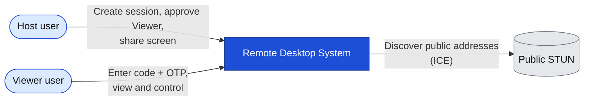
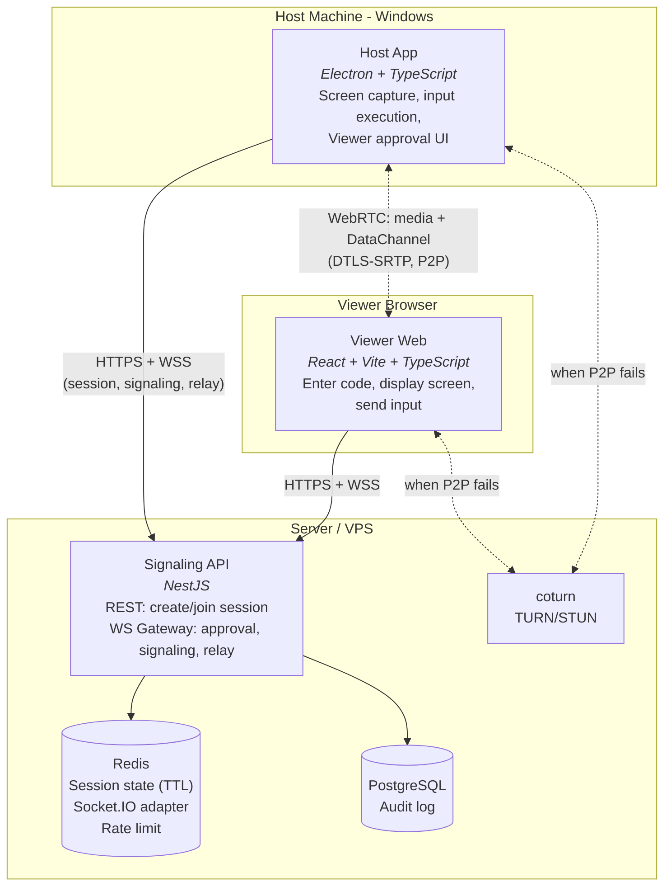
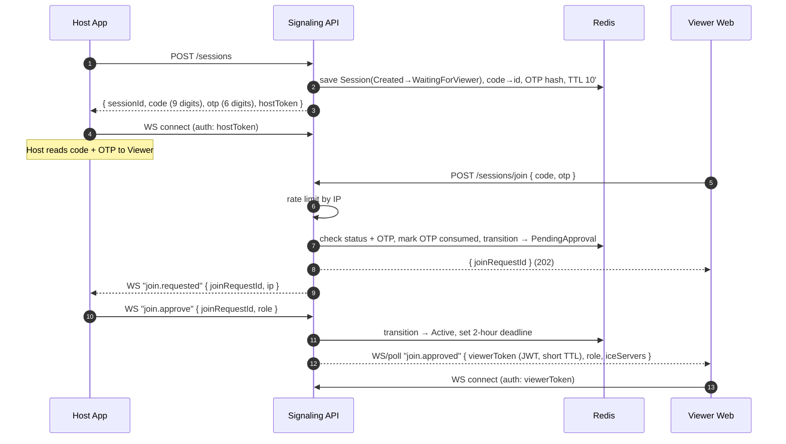
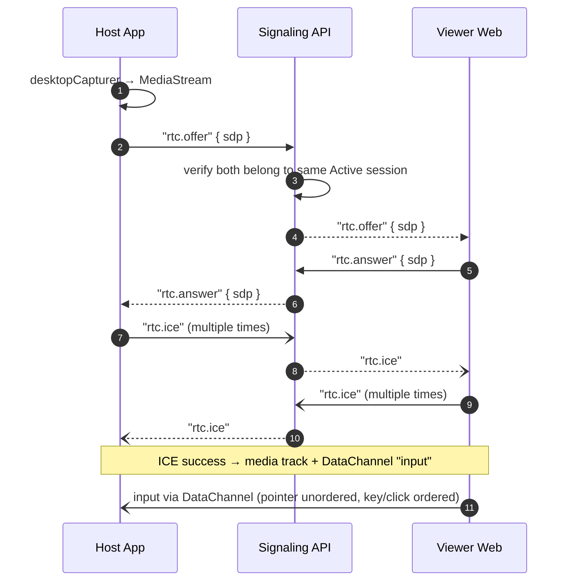
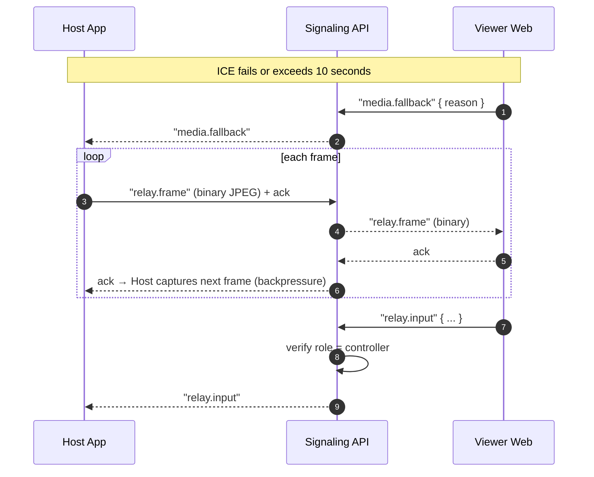
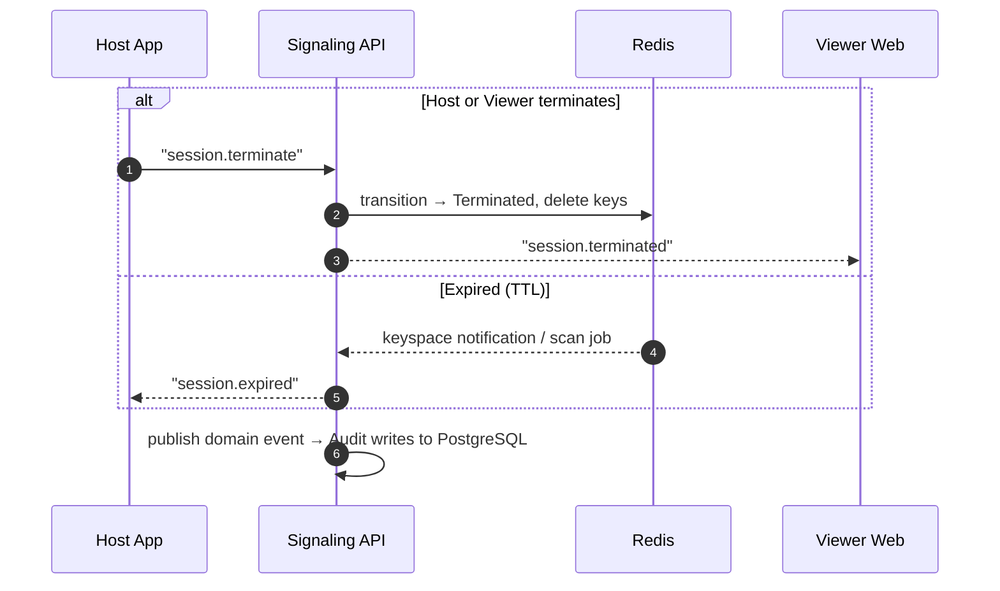
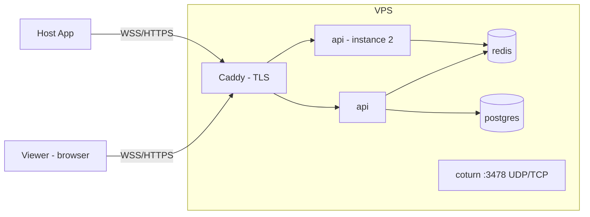

# 01 — High-Level Design

| | |
|---|---|
| Status | Draft v0.1 |
| Updated | 2026-10-23 |
| Related | [00-requirements.md](00-requirements.md) · [02-domain-model.md](02-domain-model.md) · [adr/](adr/) |

## 1. Summary

The system consists of a **Host App** (Electron) on the controlled machine, a **Viewer Web** (React) in the controlling user's browser, and a **Signaling API** (NestJS) in between to manage sessions, authentication, and the exchange of connection information.

Video and input **do not pass through the server** when WebRTC succeeds: they travel peer-to-peer (or via TURN) and are end-to-end encrypted with DTLS-SRTP. The server only relays video when using **Fallback Relay**.

## 2. C4 Level 1 — System Context

## 3. C4 Level 2 — Containers

| Container | Technology | Responsibilities | Does not do |
|---|---|---|---|
| Host App | Electron, `desktopCapturer`, `@jitsi/robotjs` | Create session, display Join Request, capture & stream screen, execute authenticated input | Does not determine permissions autonomously; permissions granted by server |
| Viewer Web | React, Vite | Enter code + OTP, display video/images, capture input, display metrics | Does not persist long-term secrets (short-lived in-memory JWT only) |
| Signaling API | NestJS, Socket.IO | Session lifecycle, authentication, issue JWT, relay signaling, Fallback Relay, rate limit, publish domain events | Does not store screen content |
| Redis | Redis 7 | Session state with TTL, code → session mapping, Socket.IO adapter, rate limit counters | Not an audit source |
| PostgreSQL | PostgreSQL 16 | Immutable audit log | Does not maintain active session state |
| coturn | coturn | TURN relay when P2P is blocked, ephemeral credentials | — |

## 4. Key flows

### 4.1 Session creation and Viewer approval (FR-01…FR-05)

### 4.2 WebRTC setup (FR-10, FR-20, FR-21)

### 4.3 Fallback Relay (FR-11)

### 4.4 Termination and expiration (FR-07, FR-08)

## 5. Deployment

**Local (development):** `docker-compose` including `api`, `redis`, `postgres`, `coturn`; Viewer runs `vite dev`; Host App runs `electron .`.

**Demo:** a single VPS running docker-compose behind Caddy/Nginx (automated TLS) with a custom domain; coturn opens UDP/TCP port 3478 and relay port ranges; Host App packaged via `electron-builder` (Windows) and released via GitHub Releases.

## 6. Quality attributes → design decisions

| NFR | Decision | ADR |
|---|---|---|
| NFR-01, NFR-02 Latency, fps | WebRTC (UDP, video codec, congestion control) for media; DataChannel for input; pointer unordered | ADR-002 |
| NFR-03 Relay bandwidth | Binary JPEG, downscaled resolution, ack-based backpressure | ADR-003 |
| NFR-04 Encryption | WSS/HTTPS via reverse proxy; WebRTC default DTLS-SRTP | ADR-002 |
| NFR-05 Brute-force protection | 9-digit code + OTP + host approval + rate limiting in Redis | ADR-004 |
| NFR-06 Robustness | Validate all payloads with shared schema; size limits | ADR-007 |
| NFR-07 Scalability | Session state in Redis, Socket.IO Redis adapter; stateless server | ADR-005 |
| NFR-08 Host security | `contextIsolation`, preload + `contextBridge`, IPC whitelist | (host-app LLD) |
| NFR-09 Quality | Clean architecture, DDD in Session & Access, TDD | ADR-006 |

## 7. Architectural risks

| Risk | Impact | Mitigation |
|---|---|---|
| Invariant "1 Viewer/session" violated when 2 instances process concurrently | Two users controlling simultaneously | Atomic state transition in Redis (Lua script or `WATCH/MULTI`) |
| ICE failure on corporate networks | Screen cannot be viewed | TURN over TCP/443; Fallback Relay |
| Native module (`robotjs`) fails to build on newer Electron | Cannot control | `@jitsi/robotjs` + `electron-rebuild`; `nut.js` fallback |
| Relay consumes server bandwidth | Cost, congestion | Limit fps/resolution on relay; use only when necessary |

## 8. Next steps

- `02-domain-model.md`: details of `RemoteSession` aggregate, invariants, state machine, domain events.
- `04-protocol.md`: WS/DataChannel and REST event table following flows in section 4.
- `05-security.md`: STRIDE for each container in section 3.
