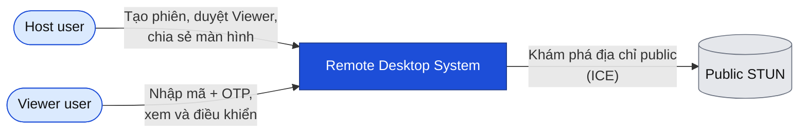
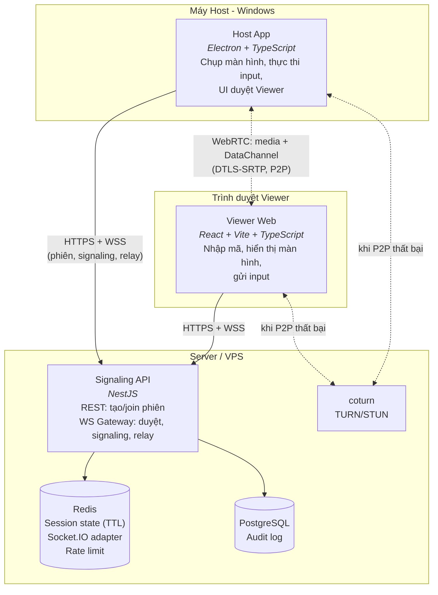
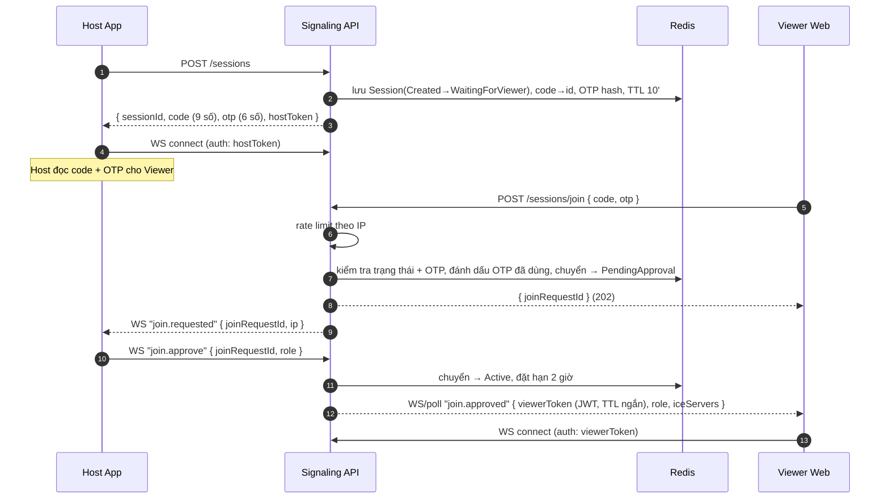
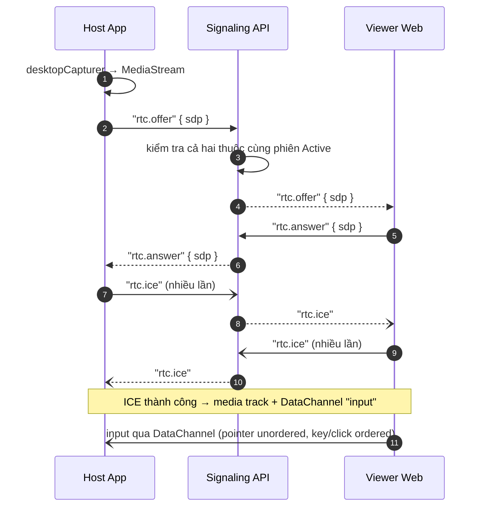
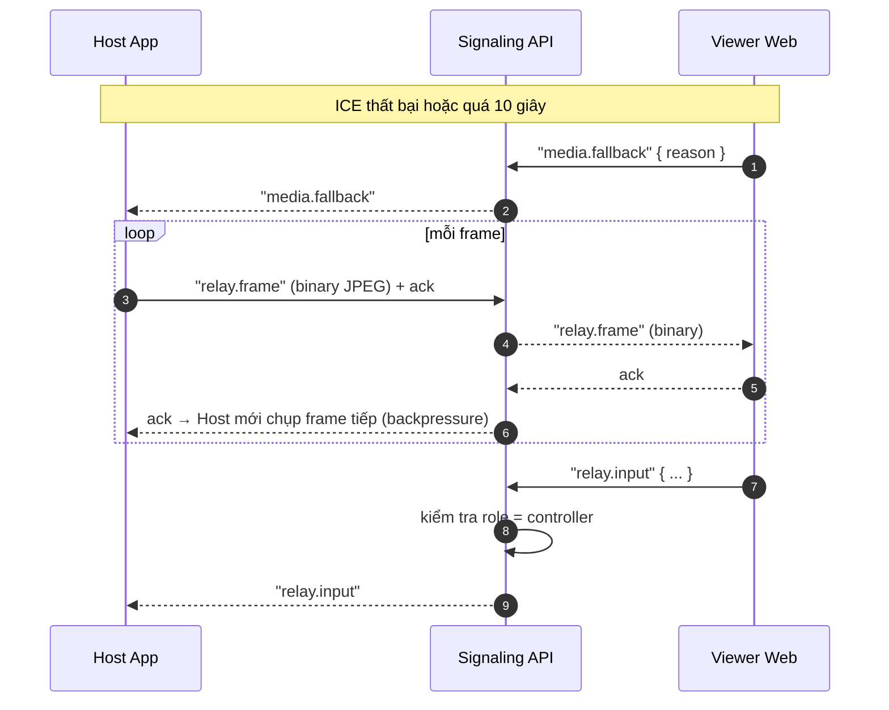
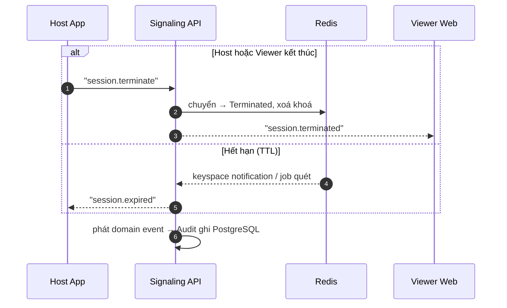
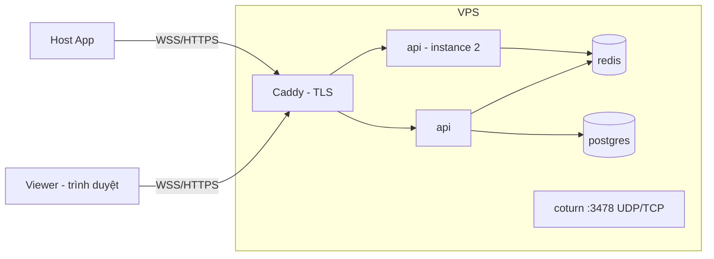

# 01 — High-Level Design

| | |
|---|---|
| Trạng thái | Draft v0.1 |
| Cập nhật | 2026-10-23 |
| Liên quan | [00-requirements.md](00-requirements.md) · [02-domain-model.md](02-domain-model.md) · [adr/](adr/) |

## 1. Tóm tắt

Hệ thống gồm một **Host App** (Electron) trên máy bị điều khiển, một **Viewer Web** (React) trên trình duyệt người điều khiển, và một **Signaling API** (NestJS) đứng giữa để quản lý phiên, xác thực và trao đổi thông tin kết nối.

Hình ảnh và input **không đi qua server** khi WebRTC thành công: chúng đi peer-to-peer (hoặc qua TURN) và được mã hoá đầu-cuối bằng DTLS-SRTP. Server chỉ chuyển hình ảnh khi phải dùng **Fallback Relay**.

## 2. C4 Level 1 — System Context

## 3. C4 Level 2 — Containers

| Container | Công nghệ | Trách nhiệm | Không làm |
|---|---|---|---|
| Host App | Electron, `desktopCapturer`, `@jitsi/robotjs` | Tạo phiên, hiển thị Join Request, chụp & stream màn hình, thực thi input đã được xác thực | Không tự quyết quyền; quyền do server cấp |
| Viewer Web | React, Vite | Nhập mã + OTP, hiển thị video/ảnh, thu input, hiển thị chỉ số | Không giữ bí mật lâu dài (chỉ JWT ngắn hạn trong bộ nhớ) |
| Signaling API | NestJS, Socket.IO | Vòng đời phiên, xác thực, cấp JWT, relay signaling, Fallback Relay, rate limit, phát domain event | Không lưu nội dung màn hình |
| Redis | Redis 7 | Trạng thái phiên có TTL, ánh xạ code → session, Socket.IO adapter, bộ đếm rate limit | Không là nguồn audit |
| PostgreSQL | PostgreSQL 16 | Audit log bất biến | Không giữ trạng thái phiên đang chạy |
| coturn | coturn | TURN relay khi P2P không thông, credential tạm thời | — |

## 4. Luồng chính

### 4.1 Tạo phiên và duyệt Viewer (FR-01…FR-05)

### 4.2 Thiết lập WebRTC (FR-10, FR-20, FR-21)

### 4.3 Fallback Relay (FR-11)

### 4.4 Kết thúc và hết hạn (FR-07, FR-08)

## 5. Deployment

**Local (phát triển):** `docker-compose` gồm `api`, `redis`, `postgres`, `coturn`; Viewer chạy `vite dev`; Host App chạy `electron .`.

**Demo:** một VPS chạy docker-compose phía sau Caddy/Nginx (TLS tự động) với domain riêng; coturn mở cổng UDP/TCP 3478 và dải cổng relay; Host App đóng gói bằng `electron-builder` (Windows) và phát hành qua GitHub Releases.

## 6. Thuộc tính chất lượng → quyết định thiết kế

| NFR | Quyết định | ADR |
|---|---|---|
| NFR-01, NFR-02 Độ trễ, fps | WebRTC (UDP, codec video, congestion control) cho media; DataChannel cho input; pointer unordered | ADR-002 |
| NFR-03 Băng thông relay | JPEG nhị phân, giảm độ phân giải, ack-based backpressure | ADR-003 |
| NFR-04 Mã hoá | WSS/HTTPS qua reverse proxy; DTLS-SRTP mặc định của WebRTC | ADR-002 |
| NFR-05 Chống dò mã | Mã 9 số + OTP + Host duyệt + rate limit trong Redis | ADR-004 |
| NFR-06 Bền vững | Validate mọi payload bằng schema dùng chung; giới hạn kích thước | ADR-007 |
| NFR-07 Mở rộng | Trạng thái phiên trong Redis, Socket.IO Redis adapter; server stateless | ADR-005 |
| NFR-08 Bảo mật Host | `contextIsolation`, preload + `contextBridge`, IPC whitelist | (LLD host-app) |
| NFR-09 Chất lượng | Clean architecture, DDD ở Session & Access, TDD | ADR-006 |

## 7. Rủi ro kiến trúc

| Rủi ro | Ảnh hưởng | Giảm thiểu |
|---|---|---|
| Invariant "1 Viewer/phiên" bị vi phạm khi 2 instance xử lý đồng thời | Hai người cùng điều khiển | Chuyển trạng thái nguyên tử trong Redis (Lua script hoặc `WATCH/MULTI`) |
| ICE thất bại ở mạng doanh nghiệp | Không xem được màn hình | TURN qua TCP/443; Fallback Relay |
| Native module (`robotjs`) không build trên Electron mới | Không điều khiển được | `@jitsi/robotjs` + `electron-rebuild`; dự phòng `nut.js` |
| Relay tiêu tốn băng thông server | Chi phí, nghẽn | Giới hạn fps/độ phân giải ở relay; chỉ dùng khi cần |

## 8. Việc tiếp theo

- `02-domain-model.md`: chi tiết aggregate `RemoteSession`, invariants, state machine, domain events.
- `04-protocol.md`: bảng sự kiện WS/DataChannel và REST theo các luồng ở mục 4.
- `05-security.md`: STRIDE cho từng container ở mục 3.
