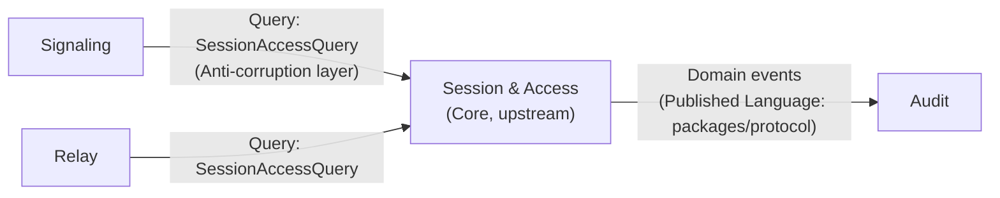
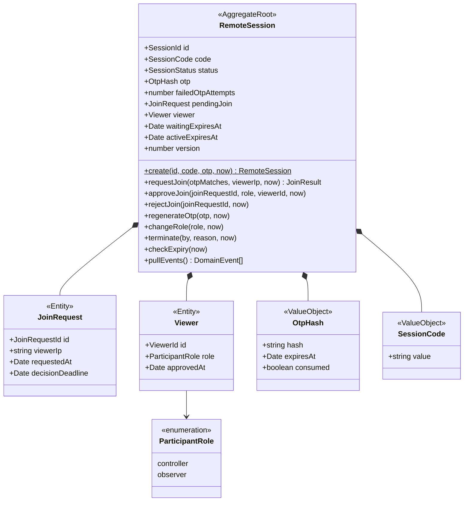
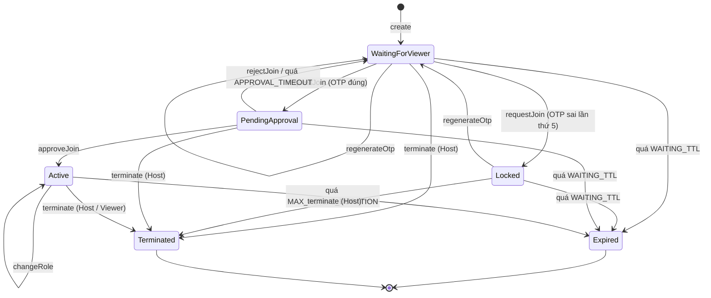

# 02 — Domain Model (DDD)

| | |
|---|---|
| Trạng thái | Draft v0.1 |
| Cập nhật | 2026-10-23 |
| Liên quan | [00-requirements.md](00-requirements.md) · [01-hld.md](01-hld.md) · ADR-004, ADR-005, ADR-006 |

## 1. Phạm vi áp dụng DDD

Domain nghiệp vụ của hệ thống nhỏ. DDD chiến thuật (aggregate, value object, domain event) chỉ dùng ở **Session & Access**, nơi có luật nghiệp vụ thật cần bảo vệ. Các phần còn lại chủ yếu là kỹ thuật và được giữ mỏng (lý do ghi trong ADR-006).

## 2. Ubiquitous language

| Thuật ngữ | Định nghĩa trong code | Ghi chú |
|---|---|---|
| Session | `RemoteSession` (aggregate root) | Một Host, tối đa một Viewer |
| Session Code | `SessionCode` (VO) | 9 chữ số, duy nhất trong số phiên còn sống |
| One-time Password | `Otp` (VO, chỉ tồn tại lúc tạo) / `OtpHash` (VO, lưu trữ) | 6 chữ số, hết hạn 10 phút |
| Join Request | `JoinRequest` (entity con) | Yêu cầu tham gia đang chờ Host duyệt |
| Approve / Reject | `approveJoin()` / `rejectJoin()` | Chỉ Host |
| Controller / Observer | `ParticipantRole` (VO) | Quyền của Viewer sau khi được duyệt |
| Lock | trạng thái `Locked` | Sau 5 lần nhập OTP sai liên tiếp |
| Terminate / Expire | trạng thái `Terminated` / `Expired` | Kết thúc chủ động / do hết thời gian |

Quy ước: tên lớp, hàm, sự kiện trong code dùng đúng các từ tiếng Anh ở cột 2; tài liệu và UI dùng cùng một bộ từ.

## 3. Bounded contexts & context map

| Context | Loại | Trách nhiệm | Mức DDD |
|---|---|---|---|
| **Session & Access** | Core | Vòng đời phiên, xác thực join, quyền của Viewer | Đầy đủ |
| Signaling | Supporting | Chuyển tiếp offer/answer/ICE giữa các bên đã được cấp quyền | Application service mỏng |
| Relay | Supporting | Chuyển frame JPEG và input khi fallback | Application service mỏng |
| Audit | Supporting | Ghi domain event vào PostgreSQL | Event subscriber |
| Media & Input (phía client) | Generic | WebRTC, chụp màn hình, ánh xạ phím | Code kỹ thuật thuần, không DDD |



- **Signaling** và **Relay** không đọc trực tiếp trạng thái aggregate. Chúng hỏi qua port `SessionAccessQuery.canRelay(sessionId, socketRole, viewerRole?)`, nên Session & Access có thể đổi cấu trúc bên trong mà không ảnh hưởng hai context này.
- **Audit** chỉ lắng nghe domain event, không gọi ngược Session & Access.

## 4. Aggregate `RemoteSession`

### 4.1 Cấu trúc



### 4.2 Value objects

| VO | Luật | Lỗi khi vi phạm |
|---|---|---|
| `SessionId`, `JoinRequestId`, `ViewerId` | UUID v4 | `InvalidIdentifier` |
| `SessionCode` | Đúng 9 chữ số `^[0-9]{9}$`; sinh bằng `crypto.randomInt`; không bắt đầu bằng `0` để dễ đọc | `InvalidSessionCode` |
| `Otp` | Đúng 6 chữ số; sinh bằng `crypto.randomInt`; **chỉ tồn tại trong bộ nhớ** lúc tạo để trả cho Host | `InvalidOtp` |
| `OtpHash` | Hash (argon2id) + `expiresAt` + `consumed`; việc so khớp (constant-time) do tầng application thực hiện rồi truyền kết quả `otpMatches` vào aggregate | — |
| `ParticipantRole` | `controller` hoặc `observer` | `InvalidRole` |

Domain không phụ thuộc thư viện hash hay đồng hồ hệ thống: kết quả so khớp OTP (`otpMatches`) và thời điểm `now` được truyền vào từ tầng application. Domain vẫn quyết định toàn bộ luật (đếm lỗi, khoá, hết hạn, đã dùng). Nhờ vậy domain là TypeScript thuần, đồng bộ, và test không cần mock thời gian toàn cục.

`requestJoin` trả về `JoinResult = { ok: true, joinRequest } | { ok: false, error }` thay vì ném lỗi, vì khi OTP sai aggregate vẫn thay đổi (bộ đếm, có thể `Locked`) và tầng application phải lưu trạng thái đó trước khi báo lỗi.

### 4.3 Hằng số nghiệp vụ

| Hằng số | Giá trị | Nguồn |
|---|---|---|
| `WAITING_TTL` | 10 phút | FR-08 |
| `OTP_TTL` | 10 phút | FR-08 |
| `MAX_FAILED_OTP_ATTEMPTS` | 5 | FR-03a |
| `APPROVAL_TIMEOUT` | 60 giây | Thiết kế (§4.5, D2) |
| `MAX_ACTIVE_DURATION` | 2 giờ | FR-09a |
| `EXPIRY_WARNING_BEFORE` | 5 phút | FR-09a |

Các hằng số nằm trong một object `SessionPolicy` truyền vào aggregate, để test có thể dùng giá trị nhỏ.

### 4.4 Invariants

| # | Invariant | Bảo vệ ở |
|---|---|---|
| I1 | Tối đa 1 Viewer (`viewer`) và tối đa 1 `pendingJoin` tại một thời điểm | Aggregate + optimistic concurrency (§6) |
| I2 | Chỉ nhận Join Request khi trạng thái là `WaitingForViewer`, OTP chưa hết hạn và chưa dùng | `requestJoin` |
| I3 | OTP chỉ dùng được một lần: bị đánh dấu `consumed` ngay khi một Join Request hợp lệ được tạo | `requestJoin` |
| I4 | Sau `MAX_FAILED_OTP_ATTEMPTS` lần sai liên tiếp, phiên chuyển `Locked`; chỉ `regenerateOtp` mở lại | `requestJoin`, `regenerateOtp` |
| I5 | Chỉ Host được approve, reject, regenerate OTP, đổi role; Host hoặc Viewer đều có thể terminate | Application layer (kiểm tra actor) + guard |
| I6 | `approveJoin`/`rejectJoin` phải đúng `joinRequestId` đang chờ và còn trong `decisionDeadline` | Aggregate |
| I7 | Phiên `Active` không kéo dài quá `MAX_ACTIVE_DURATION` kể từ lúc duyệt | `checkExpiry` + scheduler |
| I8 | `Terminated` và `Expired` là trạng thái cuối: mọi lệnh sau đó đều bị từ chối | Aggregate |
| I9 | Không có trạng thái nào lưu OTP dạng rõ | VO `OtpHash` |

### 4.5 State machine



**Quyết định thiết kế trong state machine:**
- **D1 — OTP bị tiêu thụ ngay khi tạo Join Request hợp lệ** (không phải lúc được duyệt). Nếu để đến lúc duyệt, người thứ hai biết OTP có thể gửi Join Request song song. Hệ quả: nếu Host từ chối, Host phải tạo OTP mới cho lần thử sau.
- **D2 — Join Request hết hạn sau 60 giây** nếu Host không phản hồi, phiên quay về `WaitingForViewer`. Tránh trường hợp phiên bị treo ở `PendingApproval` cho tới khi hết `WAITING_TTL`.
- **D3 — Viewer rời đi là kết thúc phiên** (không quay về `WaitingForViewer`). Đơn giản, đúng FR-07; muốn kết nối lại thì Host tạo phiên mới. Mất kết nối mạng không bị coi là rời đi ngay: tầng presentation chờ 15 giây cho kết nối lại rồi mới gọi `terminate` (LLD §6.2).
- **D4 — Đổi role là thuộc tính của `Viewer`, không phải trạng thái riêng.** Giảm số trạng thái; Observer vẫn ở `Active`.
- **D5 — Cảnh báo 5 phút trước khi hết hạn là việc của tầng application** (scheduler đọc `activeExpiresAt`), không phải một trạng thái domain.

### 4.6 Bảng chuyển trạng thái (dùng để viết test)

| Lệnh \ Trạng thái | WaitingForViewer | Locked | PendingApproval | Active | Terminated / Expired |
|---|---|---|---|---|---|
| `requestJoin` (OTP đúng) | → PendingApproval | `SessionLocked` | `JoinAlreadyPending` | `SessionOccupied` | `SessionClosed` |
| `requestJoin` (OTP sai) | đếm lỗi / → Locked | `SessionLocked` | `JoinAlreadyPending` | `SessionOccupied` | `SessionClosed` |
| `approveJoin` | `NoPendingJoin` | `NoPendingJoin` | → Active | `NoPendingJoin` | `SessionClosed` |
| `rejectJoin` | `NoPendingJoin` | `NoPendingJoin` | → WaitingForViewer | `NoPendingJoin` | `SessionClosed` |
| `regenerateOtp` | giữ nguyên, OTP mới | → WaitingForViewer | `JoinAlreadyPending` | `SessionOccupied` | `SessionClosed` |
| `changeRole` | `NoViewer` | `NoViewer` | `NoViewer` | đổi role | `SessionClosed` |
| `terminate` | → Terminated | → Terminated | → Terminated | → Terminated | `SessionClosed` |
| `checkExpiry` (quá hạn) | → Expired | → Expired | → Expired / về Waiting (D2) | → Expired | không đổi |

Mọi lỗi là lớp con của `DomainError`, có `code` ổn định để tầng presentation ánh xạ sang mã lỗi API (định nghĩa trong LLD). Với OTP sai, lỗi trả cho Viewer **không** cho biết còn bao nhiêu lần thử.

## 5. Domain events

| Sự kiện | Phát khi | Payload | Ai dùng |
|---|---|---|---|
| `SessionCreated` | `create` | sessionId, createdAt, waitingExpiresAt | Audit |
| `JoinAttemptFailed` | OTP sai | sessionId, viewerIp, attempt | Audit |
| `SessionLocked` | OTP sai lần thứ 5 | sessionId, viewerIp | Audit, thông báo Host |
| `OtpRegenerated` | `regenerateOtp` | sessionId, expiresAt | Audit |
| `JoinRequested` | OTP đúng | sessionId, joinRequestId, viewerIp, decisionDeadline | Thông báo Host, Audit |
| `JoinApproved` | `approveJoin` | sessionId, viewerId, role, activeExpiresAt | Cấp JWT cho Viewer, scheduler, Audit |
| `JoinRejected` | `rejectJoin` | sessionId, joinRequestId, reason (`rejected` \| `timeout`) | Thông báo Viewer, Audit |
| `ViewerRoleChanged` | `changeRole` | sessionId, viewerId, role | Thông báo Viewer, chặn input, Audit |
| `SessionTerminated` | `terminate` | sessionId, by (`host` \| `viewer`), reason | Ngắt kết nối hai phía, Audit |
| `SessionExpired` | `checkExpiry` | sessionId, previousStatus | Ngắt kết nối hai phía, Audit |

- Aggregate ghi event vào danh sách nội bộ; application service gọi `pullEvents()` **sau khi lưu thành công** rồi publish (NestJS `EventEmitter2` trong v1).
- Event không chứa OTP, hash hay token.
- Hạn chế đã biết: publish sau khi lưu nhưng không nằm cùng transaction, nên nếu process chết giữa chừng có thể mất event audit. Chấp nhận được cho v1; nếu cần đảm bảo tuyệt đối thì dùng outbox (ghi chú trong ADR-005).

## 6. Repository & concurrency

```ts
interface SessionRepository {
  findById(id: SessionId): Promise<RemoteSession | null>;
  findByCode(code: SessionCode): Promise<RemoteSession | null>;
  /** Lưu với optimistic concurrency: thất bại nếu version trong Redis khác expectedVersion. */
  save(session: RemoteSession, expectedVersion: number): Promise<void>;
  /** Giữ chỗ mã phiên duy nhất (SET NX + TTL). Trả false nếu mã đã tồn tại. */
  reserveCode(code: SessionCode, id: SessionId, ttlSeconds: number): Promise<boolean>;
}
```

- Mỗi lần thay đổi, `version` tăng 1. `save` dùng Lua script kiểm tra version rồi ghi trong một bước nguyên tử. Nếu hai instance cùng xử lý hai Join Request, chỉ một bên lưu được; bên còn lại nhận `ConcurrencyConflict`, application service **tải lại và thử lại tối đa 1 lần** — lần thử lại sẽ gặp `JoinAlreadyPending` đúng theo I1.
- TTL của khoá Redis đặt theo hạn của trạng thái hiện tại (`waitingExpiresAt` hoặc `activeExpiresAt`) cộng một khoảng đệm; việc chuyển sang `Expired` vẫn do `checkExpiry` quyết định để luôn phát `SessionExpired`.

## 7. Những gì không nằm trong aggregate

| Việc | Nằm ở | Lý do |
|---|---|---|
| Rate limit 5 lần/IP/phút (NFR-05) | Infrastructure (throttler + Redis) | Áp dụng xuyên nhiều phiên, không phải luật của một phiên |
| Sinh mã duy nhất | Application (`CreateSession` + `reserveCode`) | Cần biết trạng thái của mọi phiên khác |
| Cấp và kiểm tra JWT | Infrastructure (`TokenService`) | Chi tiết kỹ thuật; domain chỉ cấp `viewerId` + role |
| Cảnh báo sắp hết hạn, quét phiên hết hạn | Application (scheduler) | Phụ thuộc thời gian thực và kênh thông báo |
| Kiểm tra actor (Host hay Viewer) | Application + guard | Danh tính đến từ token, không phải từ domain |

## 8. Danh sách test cho TDD (Session & Access domain)

Viết theo thứ tự này, mỗi dòng là một test (red → green → refactor):

1. `create` → trạng thái `WaitingForViewer`, `waitingExpiresAt = now + 10'`, phát `SessionCreated`.
2. `SessionCode` từ chối chuỗi không đủ 9 chữ số / có chữ / bắt đầu bằng 0.
3. `requestJoin` OTP đúng → `PendingApproval`, OTP `consumed`, phát `JoinRequested` có `decisionDeadline = now + 60s`.
4. `requestJoin` OTP sai → giữ `WaitingForViewer`, `failedOtpAttempts + 1`, phát `JoinAttemptFailed`.
5. OTP sai lần thứ 5 → `Locked`, phát `SessionLocked`.
6. `requestJoin` khi `Locked` → `SessionLocked`, kể cả OTP đúng.
7. `regenerateOtp` khi `Locked` → `WaitingForViewer`, reset bộ đếm, OTP mới có hạn mới.
8. `requestJoin` bằng OTP đã hết hạn → lỗi, không tăng bộ đếm sai.
9. `requestJoin` lần hai khi đang `PendingApproval` → `JoinAlreadyPending` (I1, I3).
10. `approveJoin` đúng id → `Active`, `viewer.role` đúng, `activeExpiresAt = now + 2h`, phát `JoinApproved`.
11. `approveJoin` sai id hoặc sau `decisionDeadline` → lỗi tương ứng.
12. `rejectJoin` → `WaitingForViewer`, OTP vẫn `consumed` (D1), phát `JoinRejected(reason: rejected)`.
13. `checkExpiry` khi `PendingApproval` quá 60s → `WaitingForViewer`, phát `JoinRejected(reason: timeout)`.
14. `changeRole` khi `Active` → phát `ViewerRoleChanged`; khi chưa có Viewer → `NoViewer`.
15. `terminate` từ mọi trạng thái sống → `Terminated`, phát `SessionTerminated`.
16. `checkExpiry` quá `WAITING_TTL` ở Waiting/Locked/Pending → `Expired`.
17. `checkExpiry` quá 2h khi `Active` → `Expired`; trước 2h → không đổi.
18. Mọi lệnh khi `Terminated`/`Expired` → `SessionClosed` (chạy table-driven theo §4.6).
19. `version` tăng sau mỗi lệnh thành công; không tăng khi lệnh thất bại (trừ OTP sai vì có đổi bộ đếm).
20. `pullEvents()` trả event theo thứ tự và làm rỗng danh sách.

Integration test cho `RedisSessionRepository` (Testcontainers): lưu/đọc lại đầy đủ; `save` sai version → `ConcurrencyConflict`; hai `requestJoin` đồng thời chỉ một thành công; `reserveCode` trùng → `false`; TTL được đặt đúng.
