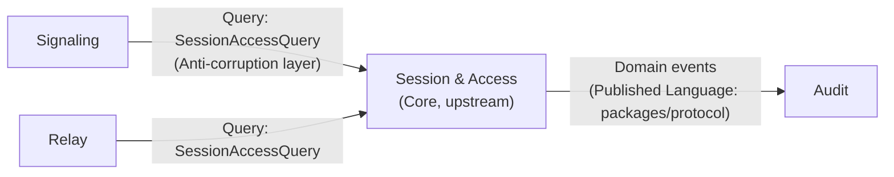
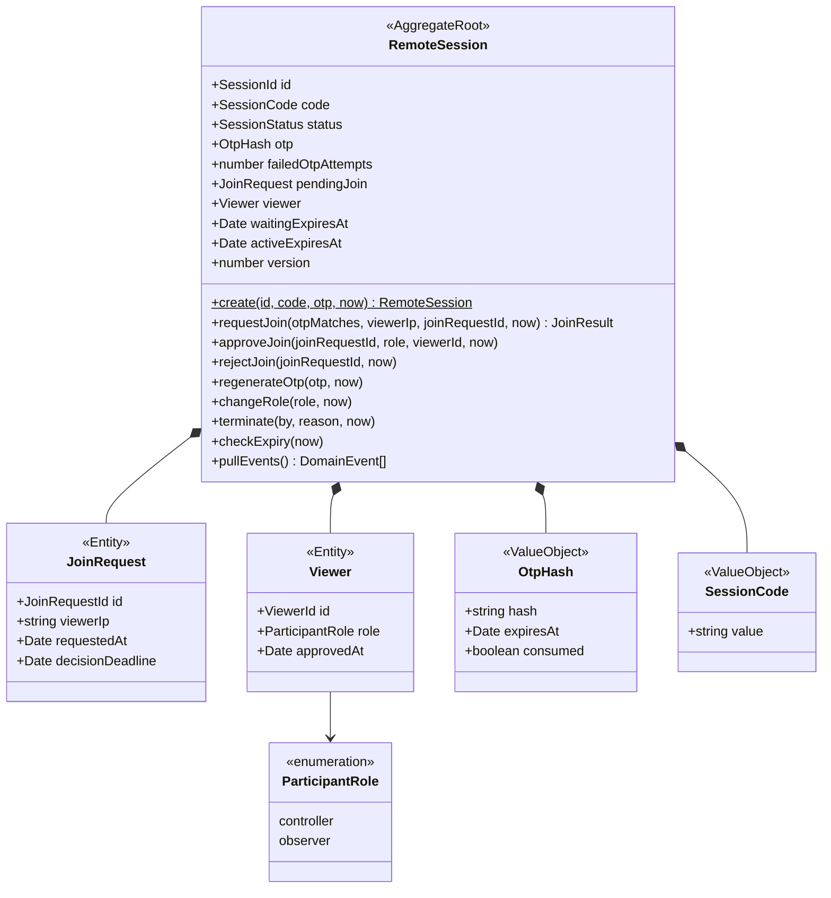
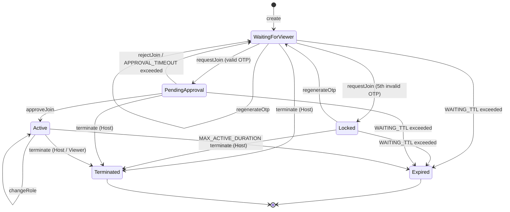

# 02 — Domain Model (DDD)

| | |
|---|---|
| Status | v0.2 — implemented (PR 2.3) |
| Updated | 2026-10-23 |
| Related | [00-requirements.md](00-requirements.md) · [01-hld.md](01-hld.md) · ADR-004, ADR-005, ADR-006 |

## 1. Scope of DDD application

The system's business domain is small. Tactical DDD (aggregate, value object, domain event) is only applied in **Session & Access**, where real business rules need protection. The remaining parts are primarily technical and kept thin (rationale documented in ADR-006).

## 2. Ubiquitous language

| Term | Definition in code | Note |
|---|---|---|
| Session | `RemoteSession` (aggregate root) | One Host, at most one Viewer |
| Session Code | `SessionCode` (VO) | 9 digits, unique among live sessions |
| One-time Password | `Otp` (VO, only exists at creation) / `OtpHash` (VO, storage) | 6 digits, expires in 10 minutes |
| Join Request | `JoinRequest` (child entity) | Join request awaiting host approval |
| Approve / Reject | `approveJoin()` / `rejectJoin()` | Host only |
| Controller / Observer | `ParticipantRole` (VO) | Viewer role after approval |
| Lock | status `Locked` | After 5 consecutive failed OTP attempts |
| Terminate / Expire | status `Terminated` / `Expired` | Explicit termination / time expiry |

Convention: class names, functions, and events in code use the exact English words in column 2; documentation and UI share the same vocabulary.

## 3. Bounded contexts & context map

| Context | Type | Responsibilities | DDD level |
|---|---|---|---|
| **Session & Access** | Core | Session lifecycle, join authentication, Viewer role | Full |
| Signaling | Supporting | Forward offer/answer/ICE between authorized parties | Thin application service |
| Relay | Supporting | Forward JPEG frames and input during fallback | Thin application service |
| Audit | Supporting | Record domain events into PostgreSQL | Event subscriber |
| Media & Input (client side) | Generic | WebRTC, screen capture, key mapping | Pure technical code, no DDD |



- **Signaling** and **Relay** do not directly read the aggregate state. They query through the port `SessionAccessQuery.canRelay(sessionId, socketRole, viewerRole?)`, allowing Session & Access to modify internal structure without affecting these two contexts.
- **Audit** only listens to domain events; it never calls back into Session & Access.

## 4. Aggregate `RemoteSession`

### 4.1 Structure



### 4.2 Value objects

| VO | Rule | Error on violation |
|---|---|---|
| `SessionId`, `JoinRequestId`, `ViewerId` | UUID v4 | `InvalidIdentifier` |
| `SessionCode` | Exactly 9 digits `^[0-9]{9}$`; generated via `crypto.randomInt`; does not start with `0` for readability | `InvalidSessionCode` |
| `Otp` | Exactly 6 digits; generated via `crypto.randomInt`; **exists only in memory** at creation time to return to Host | `InvalidOtp` |
| `OtpHash` | Hash (argon2id) + `expiresAt` + `consumed`; matching (constant-time) is performed by the application layer, which passes `otpMatches` result into the aggregate | — |
| `ParticipantRole` | `controller` or `observer` | `InvalidRole` |

The domain does not depend on hashing libraries or system clocks: the OTP matching result (`otpMatches`) and the timestamp `now` are passed in from the application layer. The domain still dictates all business rules (counting failures, locking, expiration, consumption). Thus, the domain remains pure synchronous TypeScript, and tests do not need global clock mocks.

`requestJoin` returns `JoinResult = { ok: true, joinRequest } | { ok: false, error }` instead of throwing an error, because on invalid OTP the aggregate still mutates (counter increment, potential transition to `Locked`) and the application layer must persist that state before reporting the error.

### 4.3 Business constants

| Constant | Value | Source |
|---|---|---|
| `WAITING_TTL` | 10 minutes | FR-08 |
| `OTP_TTL` | 10 minutes | FR-08 |
| `MAX_FAILED_OTP_ATTEMPTS` | 5 | FR-03a |
| `APPROVAL_TIMEOUT` | 60 seconds | Design (§4.5, D2) |
| `MAX_ACTIVE_DURATION` | 2 hours | FR-09a |
| `EXPIRY_WARNING_BEFORE` | 5 minutes | FR-09a — located in application layer, not in `SessionPolicy` (D5) |

Constants reside in a `SessionPolicy` object passed into the aggregate, allowing tests to supply smaller values.

### 4.4 Invariants

| # | Invariant | Protected at |
|---|---|---|
| I1 | At most 1 Viewer (`viewer`) and at most 1 `pendingJoin` at any time | Aggregate + optimistic concurrency (§6) |
| I2 | Only accept Join Requests when status is `WaitingForViewer`, OTP is unexpired and unconsumed | `requestJoin` |
| I3 | OTP is single-use: marked `consumed` as soon as a valid Join Request is created | `requestJoin` |
| I4 | After `MAX_FAILED_OTP_ATTEMPTS` consecutive failed attempts, session transitions to `Locked`; only `regenerateOtp` unlocks it | `requestJoin`, `regenerateOtp` |
| I5 | Only Host can approve, reject, regenerate OTP, change role; either Host or Viewer can terminate | Application layer (actor verification) + guard |
| I6 | `approveJoin`/`rejectJoin` must match the pending `joinRequestId` and be within `decisionDeadline` | Aggregate |
| I7 | `Active` session does not exceed `MAX_ACTIVE_DURATION` from approval | `checkExpiry` + scheduler |
| I8 | `Terminated` and `Expired` are terminal states: all subsequent commands are rejected | Aggregate |
| I9 | No state stores the OTP in plaintext | VO `OtpHash` |

### 4.5 State machine



**Design decisions in the state machine:**
- **D1 — OTP is consumed immediately upon creating a valid Join Request** (not when approved). If deferred until approval, a second party knowing the OTP could send concurrent Join Requests. Consequence: if Host rejects, Host must regenerate the OTP for subsequent attempts.
- **D2 — Join Request expires after 60 seconds** if Host does not respond, returning the session to `WaitingForViewer`. Prevents the session from hanging in `PendingApproval` until `WAITING_TTL` elapses.
- **D3 — Viewer leaving terminates the session** (does not revert to `WaitingForViewer`). Simple, conforms to FR-07; reconnecting requires Host to create a new session. Network disconnection is not considered an immediate departure: the presentation layer waits 15 seconds for reconnection before invoking `terminate` (LLD §6.2).
- **D4 — Changing role is an attribute of `Viewer`, not a distinct state.** Reduces state count; Observer remains in `Active`.
- **D5 — Warning 5 minutes before expiration is handled by the application layer** (scheduler inspecting `activeExpiresAt`), not a domain state.
- **D6 — `regenerateOtp` extends `waitingExpiresAt`** by `WAITING_TTL` from the time of OTP regeneration. Otherwise, Host regenerating an OTP at minute 9 would have an OTP valid until minute 19 while the session expires at minute 10. *(Decided during implementation in PR 2.3.)*

**Clarifications during implementation (PR 2.3):**
- `create` sets `version = 1`; the initial save uses `expectedVersion = 0`.
- `requestJoin` accepts an additional `joinRequestId` generated by the application layer (domain does not generate IDs). Verification order: status → consumed OTP → expired OTP → matching. Consumed or expired OTPs are **not** counted as failed attempts. Successful join resets the failure counter to 0.
- `terminate` by Viewer is only valid when the session is `Active`; other cases return `NoViewer`.
- `changeRole` to the currently held role is a no-op: no events published, `version` not incremented.
- `approveJoin` after `decisionDeadline` returns `JoinRequestExpired` without changing status; transitioning the session back to `WaitingForViewer` is handled by `checkExpiry` (D2).
- When `checkExpiry` observes that both `waitingExpiresAt` and `decisionDeadline` have passed, `Expired` takes precedence.
- `SessionPolicy` does not contain `EXPIRY_WARNING_BEFORE` (D5).

### 4.6 State transition table (used for test authoring)

| Command \ Status | WaitingForViewer | Locked | PendingApproval | Active | Terminated / Expired |
|---|---|---|---|---|---|
| `requestJoin` (valid OTP) | → PendingApproval | `SessionLocked` | `JoinAlreadyPending` | `SessionOccupied` | `SessionClosed` |
| `requestJoin` (invalid OTP) | count failure / → Locked | `SessionLocked` | `JoinAlreadyPending` | `SessionOccupied` | `SessionClosed` |
| `approveJoin` | `NoPendingJoin` | `NoPendingJoin` | → Active | `NoPendingJoin` | `SessionClosed` |
| `rejectJoin` | `NoPendingJoin` | `NoPendingJoin` | → WaitingForViewer | `NoPendingJoin` | `SessionClosed` |
| `regenerateOtp` | unchanged, new OTP | → WaitingForViewer | `JoinAlreadyPending` | `SessionOccupied` | `SessionClosed` |
| `changeRole` | `NoViewer` | `NoViewer` | `NoViewer` | change role | `SessionClosed` |
| `terminate` | → Terminated | → Terminated | → Terminated | → Terminated | `SessionClosed` |
| `checkExpiry` (expired) | → Expired | → Expired | → Expired / revert to Waiting (D2) | → Expired | unchanged |

All errors are subclasses of `DomainError` with stable `code`s mapped by the presentation layer to API error codes (defined in LLD). For invalid OTP, the error returned to Viewer does **not** disclose remaining attempt count.

## 5. Domain events

| Event | Published when | Payload | Consumers |
|---|---|---|---|
| `SessionCreated` | `create` | sessionId, createdAt, waitingExpiresAt | Audit |
| `JoinAttemptFailed` | invalid OTP | sessionId, viewerIp, attempt | Audit |
| `SessionLocked` | 5th invalid OTP | sessionId, viewerIp | Audit, Host notification |
| `OtpRegenerated` | `regenerateOtp` | sessionId, expiresAt | Audit |
| `JoinRequested` | valid OTP | sessionId, joinRequestId, viewerIp, decisionDeadline | Host notification, Audit |
| `JoinApproved` | `approveJoin` | sessionId, viewerId, role, activeExpiresAt | Issue JWT to Viewer, scheduler, Audit |
| `JoinRejected` | `rejectJoin` | sessionId, joinRequestId, reason (`rejected` \| `timeout`) | Viewer notification, Audit |
| `ViewerRoleChanged` | `changeRole` | sessionId, viewerId, role | Viewer notification, block input, Audit |
| `SessionTerminated` | `terminate` | sessionId, by (`host` \| `viewer`), reason | Disconnect both parties, Audit |
| `SessionExpired` | `checkExpiry` | sessionId, previousStatus | Disconnect both parties, Audit |

- The aggregate records events in an internal list; the application service calls `pullEvents()` **after a successful save** and publishes them (NestJS `EventEmitter2` in v1).
- Events do not contain OTPs, hashes, or tokens.
- Known limitation: publishing occurs after save without a shared transaction, so a process crash in between could lose audit events. Acceptable for v1; if strict guarantees are needed, use an outbox pattern (noted in ADR-005).

## 6. Repository & concurrency

```ts
interface SessionRepository {
  findById(id: SessionId): Promise<RemoteSession | null>;
  findByCode(code: SessionCode): Promise<RemoteSession | null>;
  /** Save with optimistic concurrency: fails if version in Redis differs from expectedVersion. */
  save(session: RemoteSession, expectedVersion: number): Promise<void>;
  /** Reserve unique session code (SET NX + TTL). Returns false if code already exists. */
  reserveCode(code: SessionCode, id: SessionId, ttlSeconds: number): Promise<boolean>;
}
```

- On each mutation, `version` increments by 1. `save` uses a Lua script to check the version and write in a single atomic step. If two instances process two Join Requests concurrently, only one succeeds; the other receives `ConcurrencyConflict`, and the application service **reloads and retries at most once** — the retry will encounter `JoinAlreadyPending` per I1.
- Redis key TTL is set according to the deadline of the current status (`waitingExpiresAt` or `activeExpiresAt`) plus a buffer; transitioning to `Expired` is still determined by `checkExpiry` to ensure `SessionExpired` is always published.

## 7. What is not in the aggregate

| Concern | Located in | Rationale |
|---|---|---|
| Rate limit 5 attempts/IP/minute (NFR-05) | Infrastructure (throttler + Redis) | Applies across multiple sessions, not a single session rule |
| Unique code generation | Application (`CreateSession` + `reserveCode`) | Requires knowledge of all other sessions' states |
| JWT issuance and verification | Infrastructure (`TokenService`) | Technical detail; domain only issues `viewerId` + role |
| Expiration warning, scanning expired sessions | Application (scheduler) | Depends on real-time clock and notification channels |
| Actor check (Host or Viewer) | Application + guard | Identity originates from token, not from domain |

## 8. Test list for TDD (Session & Access domain)

Written in this order, each line representing one test (red → green → refactor):

1. `create` → status `WaitingForViewer`, `waitingExpiresAt = now + 10'`, publishes `SessionCreated`.
2. `SessionCode` rejects string without 9 digits / containing non-digits / starting with 0.
3. `requestJoin` valid OTP → `PendingApproval`, OTP `consumed`, publishes `JoinRequested` with `decisionDeadline = now + 60s`.
4. `requestJoin` invalid OTP → retains `WaitingForViewer`, `failedOtpAttempts + 1`, publishes `JoinAttemptFailed`.
5. 5th invalid OTP → `Locked`, publishes `SessionLocked`.
6. `requestJoin` when `Locked` → `SessionLocked`, even with valid OTP.
7. `regenerateOtp` when `Locked` → `WaitingForViewer`, resets counter, new OTP with new expiry.
8. `requestJoin` with expired OTP → error, does not increment failure counter.
9. A second `requestJoin` while `PendingApproval` → `JoinAlreadyPending` (I1, I3).
10. `approveJoin` matching ID → `Active`, `viewer.role` correct, `activeExpiresAt = now + 2h`, publishes `JoinApproved`.
11. `approveJoin` wrong ID or after `decisionDeadline` → corresponding error.
12. `rejectJoin` → `WaitingForViewer`, OTP remains `consumed` (D1), publishes `JoinRejected(reason: rejected)`.
13. `checkExpiry` when `PendingApproval` exceeds 60s → `WaitingForViewer`, publishes `JoinRejected(reason: timeout)`.
14. `changeRole` when `Active` → publishes `ViewerRoleChanged`; without Viewer → `NoViewer`.
15. `terminate` from any live status → `Terminated`, publishes `SessionTerminated`.
16. `checkExpiry` exceeding `WAITING_TTL` in Waiting/Locked/Pending → `Expired`.
17. `checkExpiry` exceeding 2h when `Active` → `Expired`; before 2h → unchanged.
18. Any command when `Terminated`/`Expired` → `SessionClosed` (run table-driven per §4.6).
19. `version` increments after each successful command; does not increment on failed commands (except invalid OTP due to counter update).
20. `pullEvents()` returns events in order and empties the list.

Integration tests for `RedisSessionRepository` (Testcontainers): full save/read roundtrip; `save` with wrong version → `ConcurrencyConflict`; two concurrent `requestJoin`s with only one succeeding; duplicate `reserveCode` → `false`; TTL set correctly.
