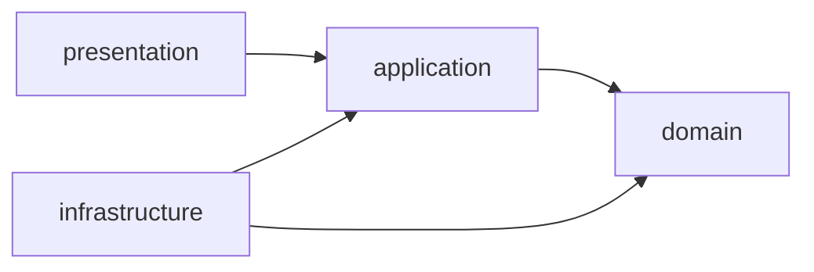
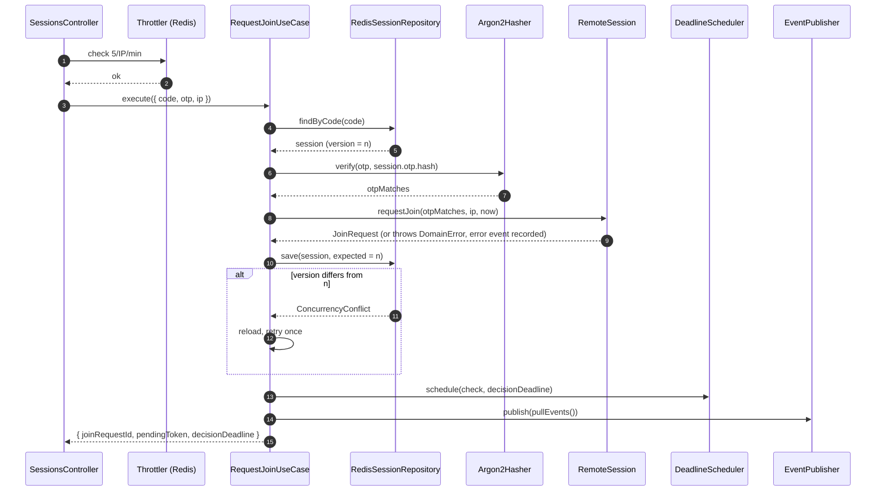

# 03 — LLD: Session & Access (apps/server)

| | |
|---|---|
| Status | v0.2 — domain + application implemented (PR 2.3, 2.4) |
| Updated | 2026-10-23 |
| Related | [02-domain-model.md](../02-domain-model.md) · [04-protocol.md](../04-protocol.md) · ADR-004, ADR-005, ADR-006 |

## 1. Responsibilities

Implement the **Session & Access** context: create sessions, authenticate Join Requests, host approval, manage roles, terminate and expire sessions; issue tokens; publish domain events; provide `SessionAccessQuery` for Signaling and Relay.

Does not do: relay SDP/ICE (Signaling), transfer frames (Relay), record audit logs (Audit — only listens to events).

## 2. Directory structure

```
apps/server/src/
├─ main.ts                          # bootstrap, Socket.IO Redis adapter, pino
├─ app.module.ts
├─ shared/
│  ├─ config/                       # @nestjs/config + zod validate env
│  ├─ errors/domain-error.ts        # base class DomainError { code }
│  ├─ errors/error-mapper.ts        # DomainError → { http, code } (table 04-protocol §7)
│  ├─ filters/http-exception.filter.ts
│  ├─ filters/ws-exception.filter.ts
│  └─ validation/zod.pipe.ts
└─ session-access/
   ├─ domain/                       # pure TypeScript — NO imports of @nestjs, ioredis, jsonwebtoken
   │  ├─ remote-session.ts          # aggregate root
   │  ├─ join-request.ts, viewer.ts
   │  ├─ value-objects/             # session-id, session-code, otp, otp-hash, participant-role
   │  ├─ session-policy.ts          # business constants (02 §4.3)
   │  ├─ events.ts                  # union DomainEvent
   │  ├─ errors.ts                  # OtpMismatch, SessionLocked, NoPendingJoin, …
   │  └─ ports.ts                   # SecretVerifier (domain service interface)
   ├─ application/
   │  ├─ ports/                     # SessionRepository, SecretHasher, CodeGenerator, OtpGenerator,
   │  │                             # IdGenerator, Clock, TokenService, EventPublisher, DeadlineScheduler
   │  ├─ use-cases/
   │  │  ├─ create-session.ts
   │  │  ├─ request-join.ts
   │  │  ├─ approve-join.ts
   │  │  ├─ reject-join.ts
   │  │  ├─ regenerate-otp.ts
   │  │  ├─ change-viewer-role.ts
   │  │  ├─ terminate-session.ts
   │  │  └─ process-due-deadlines.ts
   │  ├─ queries/session-access.query.ts
   │  └─ support/with-retry.ts      # reloads + retries once on ConcurrencyConflict
   ├─ infrastructure/
   │  ├─ redis/redis-session.repository.ts
   │  ├─ redis/redis-deadline.scheduler.ts
   │  ├─ redis/lua/save-session.lua
   │  ├─ redis/session.mapper.ts    # aggregate ⇄ JSON
   │  ├─ crypto/argon2.hasher.ts
   │  ├─ crypto/random-code.generator.ts
   │  ├─ jwt/jwt-token.service.ts
   │  ├─ turn/turn-credentials.service.ts
   │  ├─ events/event-emitter.publisher.ts
   │  └─ system-clock.ts
   ├─ presentation/
   │  ├─ sessions.controller.ts     # POST /v1/sessions, POST /v1/sessions/join
   │  ├─ session.gateway.ts         # namespace /session
   │  ├─ ws-auth.middleware.ts      # authenticates handshake, attaches principal
   │  ├─ actor.guard.ts             # @Actor('host' | 'viewer')
   │  └─ notifiers/participant.notifier.ts   # domain event → emit to room
   └─ session-access.module.ts      # wires port ↔ adapter using custom providers
```

## 3. Dependency rules



- `domain` depends on nothing outside standard TypeScript.
- `application` knows only interfaces (ports), with no knowledge of Redis or JWT.
- `infrastructure` implements ports; `presentation` calls use cases.
- Automated verification via `dependency-cruiser` in CI (rule: `domain` must not import `application|infrastructure|presentation|@nestjs|ioredis|jsonwebtoken|argon2`).

## 4. Ports

```ts
// application/ports
interface SessionRepository { /* see 02-domain-model §6 */ }

interface SecretHasher {            // implements SecretVerifier of domain
  hash(plain: string): Promise<string>;
  verify(plain: string, hash: string): Promise<boolean>;   // constant-time
}

interface CodeGenerator { next(): SessionCode }            // crypto.randomInt
interface OtpGenerator  { next(): Otp }
interface IdGenerator   { uuid(): string }
interface Clock         { now(): Date }

interface TokenService {
  issueHost(sessionId: SessionId, expiresAt: Date): string;
  issuePending(sessionId: SessionId, joinRequestId: JoinRequestId, expiresAt: Date): string;
  issueViewer(sessionId: SessionId, viewerId: ViewerId, expiresAt: Date): string;
  verify(token: string): Principal;                         // throws UnauthorizedError
}

interface EventPublisher { publish(events: DomainEvent[]): Promise<void> }

interface DeadlineScheduler {
  /** Sets (overwrites) the session's next check deadline; used for expiration, approval timeout, and warnings. */
  schedule(sessionId: SessionId, at: Date, kind: "check" | "warn"): Promise<void>;
  cancel(sessionId: SessionId): Promise<void>;
}
```

`SecretVerifier` in the domain only contains `verify` and is conceptually synchronous; because argon2 is async, `requestJoin` on the aggregate receives the match **result** (`otpMatches: boolean`) precalculated by the use case. The domain still determines correctness (error counting, locking, expiration, consumption); hashing remains outside.

## 5. Use cases

Every use case receives `actor: Principal` (from the token) and returns a result or throws `DomainError`. Common template:

```ts
async execute(cmd) {
  return withRetry(async () => {                    // up to 2 attempts on ConcurrencyConflict
    const session = await repo.findById(cmd.sessionId) ?? throwSessionClosed();
    assertActor(cmd.actor, session);                // I5
    const expected = session.version;
    session.<command>(…, clock.now());
    await repo.save(session, expected);
    await scheduler.schedule(…);                    // updates deadline
    await publisher.publish(session.pullEvents());
    return <dto>;
  });
}
```

| Use case | Actor | Key steps | Result | Errors |
|---|---|---|---|---|
| **CreateSession** | anonymous (rate limited) | generate `code` → `reserveCode` (up to 5 attempts) → generate OTP → hash → `RemoteSession.create` → save → schedule `check` at `waitingExpiresAt` → Host token | `{ sessionId, code, otp, …, hostToken }` | `CODE_SPACE_EXHAUSTED` |
| **RequestJoin** | anonymous (rate limited) | `findByCode` → if not found: throw `InvalidCredentials` → verify OTP → `session.requestJoin(otpMatches, ip, now)` → save → schedule `check` at `decisionDeadline` → pending token | `{ joinRequestId, pendingToken, decisionDeadline }` | all authentication failures → `INVALID_CREDENTIALS` |
| **ApproveJoin** | host | `approveJoin(jrId, role, newViewerId, now)` → save → schedule `warn` at `activeExpiresAt − 5'` and `check` at `activeExpiresAt` | `{ viewerId, activeExpiresAt }`; notifier sends `join.approved` with `viewerToken` + `iceServers` | `NO_PENDING_JOIN`, `JOIN_REQUEST_EXPIRED` |
| **RejectJoin** | host | `rejectJoin(jrId, now)` → save → schedule `check` at `waitingExpiresAt` | `{}` | `NO_PENDING_JOIN` |
| **RegenerateOtp** | host | generate OTP → hash → `regenerateOtp(otpHash, now)` → save | `{ otp, otpExpiresAt }` | `JOIN_ALREADY_PENDING`, `SESSION_OCCUPIED` |
| **ChangeViewerRole** | host | `changeRole(role, now)` → save | `{ role }` | `NO_VIEWER` |
| **TerminateSession** | host, viewer | `terminate(by, reason, now)` → save → `scheduler.cancel` → `repo` sets short TTL (60s) for sockets to receive notifications in time | `{}` | `SESSION_CLOSED` |
| **ProcessDueDeadlines** | system | for each due session: `kind=warn` → publish `SessionExpiring`; `kind=check` → `checkExpiry(now)` → save → publish | — | ignores `SESSION_CLOSED` |

**Why does RequestJoin throw `InvalidCredentials` before verification when code is not found?** Differing response times could reveal whether a code exists. The use case still executes a dummy `verify` with a fixed dummy hash when the session is not found so response times remain equivalent (timing attack mitigation).

`SessionExpiring` is an **application event** (not a domain event) because it does not alter aggregate state.

**Adjustments during implementation (PR 2.4):**
- Host/Viewer commands do **not** take a separate `sessionId`: the session is always the one recorded in the caller's token, preventing targeting another session. The use case only validates the actor kind (`assertHost`, `assertHostOrViewer`).
- `ApproveJoin` directly returns `viewerToken` (instead of letting the notifier issue it), keeping token issuance inside the use case and testable.
- Helper `commit(session, expectedVersion)`: does nothing if `version` has not changed; if changed: `save` → schedule `scheduler` per `session.nextCheckAt()` (or `cancel` when the session is closed) → `publish`.
- Domain adds `nextCheckAt()`: the earliest deadline at which `checkExpiry` can transition state. The use case does not calculate deadlines manually.
- `ProcessDueDeadlines.execute(due[])` processes each deadline independently and **returns a list of infrastructure errors** for the scheduler to retry later; business errors (session closed, bad id) are ignored.
- `hostToken` expires after `WAITING_TTL + MAX_ACTIVE_DURATION`. Known limitation: if the Host regenerates the OTP multiple times (D6), the session may outlive the token — to be addressed via token refresh over WS in the gateway PR.

### 5.1 Internal sequence — RequestJoin



Note: on an incorrect OTP, the aggregate **still changes** (increments counter, may transition to `Locked`), so the use case must `save` and `publish` before throwing the error externally. The aggregate returns `{ ok: false, error }` for this command instead of throwing immediately, enabling the use case to persist state before throwing.

## 6. Presentation

### 6.1 REST — `SessionsController`
- `POST /v1/sessions` → `CreateSession`; throttle 10/IP/min.
- `POST /v1/sessions/join` → `ZodPipe(JoinRequestBody)` → `RequestJoin`; throttle 5/IP/min (`@nestjs/throttler` with Redis storage to share counts across instances).
- `HttpExceptionFilter` uses `error-mapper` to return `{ code, message }`; unhandled errors → `INTERNAL` + log `requestId`.
- IP extracted from `X-Forwarded-For` **only when** request passes through a trusted proxy (`app.set('trust proxy', 1)`).

### 6.2 WebSocket — `SessionGateway`
- `@WebSocketGateway({ namespace: '/session', maxHttpBufferSize: 1e6 })`, Socket.IO Redis adapter to emit to rooms from any instance.
- `WsAuthMiddleware` (handshake): checks `protocolVersion`, `TokenService.verify`, verifies session is alive, attaches `socket.data.principal`, joins room per 04-protocol §4.1, replaces existing socket with same role.
- Each handler: `@Actor('host')` → `ZodPipe(schema)` → use case → returns `Ack`.
- `WsExceptionFilter` converts all errors to `{ ok: false, error }` in ack, never letting exceptions drop the connection.
- `handleDisconnect`: Viewer socket disconnect does **not** terminate the session immediately; waits 15 seconds for reconnect (flaky network), on timeout calls `TerminateSession(by: viewer, reason: "disconnected")` (D3).

### 6.3 Notifier
`ParticipantNotifier` listens to domain/application events and emits:

| Event | Emit |
|---|---|
| `JoinRequested` | `s:{id}:host` ← `join.requested` |
| `JoinApproved` | `jr:{jrId}` ← `join.approved` (with `viewerToken`, `iceServers` generated here) |
| `JoinRejected` | `jr:{jrId}` ← `join.rejected` |
| `SessionLocked` | host ← `session.locked` |
| `ViewerRoleChanged` | viewer **and** host ← `viewer.role.changed` |
| `SessionExpiring` | host, viewer ← `session.expiring` |
| `SessionTerminated` / `SessionExpired` | host, viewer (, pending) ← corresponding event, followed by `disconnectSockets()` for the session's rooms |

## 7. Redis storage

| Key | Type | Content | TTL |
|---|---|---|---|
| `sess:{id}` | string (JSON) | Serialized aggregate, includes `version` | current state deadline + 5 minutes |
| `code:{code}` | string | `sessionId` | as above; deleted when session terminates |
| `deadlines` | sorted set | member `"{id}:{kind}"`, score = epoch ms | — |
| `throttle:*` | managed by throttler | | |

`save-session.lua` (atomic):
```lua
-- KEYS[1] = sess:{id}; ARGV[1] = expectedVersion; ARGV[2] = json; ARGV[3] = ttlSeconds
local current = redis.call('GET', KEYS[1])
if current then
  local v = cjson.decode(current).version
  if v ~= tonumber(ARGV[1]) then return 0 end
elseif tonumber(ARGV[1]) ~= 0 then
  return 0
end
redis.call('SET', KEYS[1], ARGV[2], 'EX', ARGV[3])
return 1
```
Returns `0` → repository throws `ConcurrencyConflict`. When the session transitions to `Terminated/Expired`, the repository deletes `code:{code}` so the code can be reused.

**Implemented (PR 2.5):**
- Script resides in `infrastructure/redis/save-session.lua.ts` (TypeScript string instead of `.lua` file to avoid copying assets during build); invoked via `EVAL` with 2 keys: `sess:{id}`, `code:{code}`.
- TTL = duration until `session.nextCheckAt()` (per injected `Clock`) + 5-minute buffer; closed sessions are retained for 60 seconds. The `code:` key is refreshed with the same TTL as the session.
- Closed session only deletes `code:{code}` if the key **still points to this session**, preventing accidental deletion of a code already reserved by another session.
- `RedisDeadlineScheduler.claimDue(now, limit)` implements steps 1–2 of §8; the `@Interval` loop and rescheduling failed deadlines will reside in the NestJS module.
- Redis Cluster not yet supported (two keys in one script may hash to different slots); use hash tag `{id}` if needed later.

## 8. Multi-instance scheduler

`RedisDeadlineScheduler` + `@Interval(1000)` in `ProcessDueDeadlines`:
1. `ZRANGEBYSCORE deadlines -inf now LIMIT 0 50`.
2. For each member, **claim processing ownership** via `ZREM deadlines member` — only the instance returning `1` processes it, preventing two instances from handling the same deadline.
3. Call the corresponding use case; on transient errors (Redis), `ZADD` back with score `now + 5s`.

Maximum expiration latency is ~1 second, sufficient for requirements. Redis TTL is only a garbage collection safety net, not the primary expiration mechanism.

## 9. Configuration

| Variable | Example | Notes |
|---|---|---|
| `PORT` | `3000` | |
| `REDIS_URL` | `redis://redis:6379` | |
| `DATABASE_URL` | `postgres://…` | Used by Audit |
| `JWT_SECRET` | 32+ random bytes | Required; app will not start if missing/short |
| `TURN_URLS` | `turn:turn.example.com:3478?transport=udp,…` | |
| `TURN_SECRET` | | Shared with coturn `static-auth-secret` |
| `TRUST_PROXY` | `1` | |
| `SESSION_POLICY_*` | | Overrides constants for e2e tests (e.g. short TTL) |

All environment variables are validated with zod at startup.

## 10. Logging & observability

- `nestjs-pino`, JSON, every log includes `requestId` or `socketId` and `sessionId`.
- `redact`: `otp`, `*.token`, `authorization`, `auth.token`.
- Log at `info` level for all domain events (also serving as source for Audit), `warn` for rate limiting and `SessionLocked`.

## 11. Testing (per 06-test-strategy)

| Layer | Target | Approach |
|---|---|---|
| Unit — domain | `RemoteSession`, VO | 20 tests in 02-domain-model §8, table-driven per §4.6; `SessionPolicy` with small constants |
| Unit — application | each use case | In-memory fake ports (`InMemorySessionRepository`, `FixedClock`, `FakeHasher`); verify save → schedule → publish order; verify retry on `ConcurrencyConflict` |
| Integration | `RedisSessionRepository`, `RedisDeadlineScheduler`, Lua script | Testcontainers Redis: version conflict, two parallel `requestJoin` calls, claiming deadline ownership between two schedulers |
| E2E — REST | `SessionsController` | Supertest + Testcontainers: create session, invalid/valid join, 6 failed attempts → 401 + Host receives `session.locked`, rate limit 429 |
| E2E — WS | `SessionGateway` | Real `socket.io-client`: full flow create → join → approve → change role → terminate; invalid/expired token; Viewer calling Host command → `FORBIDDEN`; two server instances sharing Redis adapter |
| Architecture | dependency rules | `dependency-cruiser` in CI |

## 12. Implementation order (mapped to Week 2 plan)

1. `shared/errors`, `domain/value-objects` + test.
2. `RemoteSession` via TDD (02 §8).
3. Port + use case with in-memory adapter + test.
4. `RedisSessionRepository` + Lua + integration test.
5. `JwtTokenService`, `Argon2Hasher`, `RandomCodeGenerator`.
6. Controller + throttler + e2e REST.
7. Gateway + middleware + notifier + e2e WS.
8. Scheduler + integration test.
