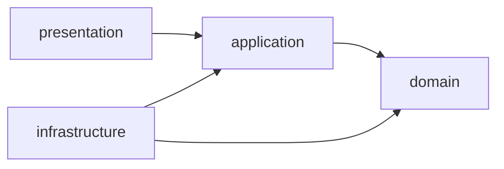
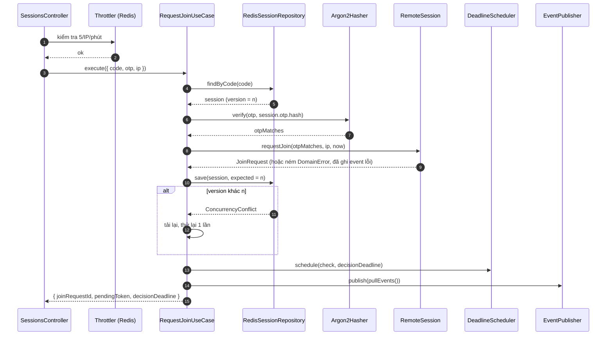

# 03 — LLD: Session & Access (apps/server)

| | |
|---|---|
| Trạng thái | Draft v0.1 |
| Cập nhật | 2026-10-23 |
| Liên quan | [02-domain-model.md](../02-domain-model.md) · [04-protocol.md](../04-protocol.md) · ADR-004, ADR-005, ADR-006 |

## 1. Trách nhiệm

Hiện thực context **Session & Access**: tạo phiên, xác thực Join Request, Host duyệt, quản lý role, kết thúc và hết hạn phiên; cấp token; phát domain event; cung cấp `SessionAccessQuery` cho Signaling và Relay.

Không làm: chuyển tiếp SDP/ICE (Signaling), chuyển frame (Relay), ghi audit (Audit — chỉ lắng nghe event).

## 2. Cấu trúc thư mục

```
apps/server/src/
├─ main.ts                          # bootstrap, Socket.IO Redis adapter, pino
├─ app.module.ts
├─ shared/
│  ├─ config/                       # @nestjs/config + zod validate env
│  ├─ errors/domain-error.ts        # lớp cơ sở DomainError { code }
│  ├─ errors/error-mapper.ts        # DomainError → { http, code } (bảng 04-protocol §7)
│  ├─ filters/http-exception.filter.ts
│  ├─ filters/ws-exception.filter.ts
│  └─ validation/zod.pipe.ts
└─ session-access/
   ├─ domain/                       # TypeScript thuần — KHÔNG import @nestjs, ioredis, jsonwebtoken
   │  ├─ remote-session.ts          # aggregate root
   │  ├─ join-request.ts, viewer.ts
   │  ├─ value-objects/             # session-id, session-code, otp, otp-hash, participant-role
   │  ├─ session-policy.ts          # hằng số nghiệp vụ (02 §4.3)
   │  ├─ events.ts                  # union DomainEvent
   │  ├─ errors.ts                  # OtpMismatch, SessionLocked, NoPendingJoin, …
   │  └─ ports.ts                   # SecretVerifier (domain service interface)
   ├─ application/
   │  ├─ ports/                     # SessionRepository, SecretHasher, CodeGenerator, OtpGenerator,
   │  │                             # IdGenerator, Clock, TokenService, EventPublisher, DeadlineScheduler
   │  ├─ use-cases/
   │  │  ├─ create-session.ts
   │  │  ├─ request-join.ts
   │  │  ├─ approve-join.ts
   │  │  ├─ reject-join.ts
   │  │  ├─ regenerate-otp.ts
   │  │  ├─ change-viewer-role.ts
   │  │  ├─ terminate-session.ts
   │  │  └─ process-due-deadlines.ts
   │  ├─ queries/session-access.query.ts
   │  └─ support/with-retry.ts      # tải lại + thử lại 1 lần khi ConcurrencyConflict
   ├─ infrastructure/
   │  ├─ redis/redis-session.repository.ts
   │  ├─ redis/redis-deadline.scheduler.ts
   │  ├─ redis/lua/save-session.lua
   │  ├─ redis/session.mapper.ts    # aggregate ⇄ JSON
   │  ├─ crypto/argon2.hasher.ts
   │  ├─ crypto/random-code.generator.ts
   │  ├─ jwt/jwt-token.service.ts
   │  ├─ turn/turn-credentials.service.ts
   │  ├─ events/event-emitter.publisher.ts
   │  └─ system-clock.ts
   ├─ presentation/
   │  ├─ sessions.controller.ts     # POST /v1/sessions, POST /v1/sessions/join
   │  ├─ session.gateway.ts         # namespace /session
   │  ├─ ws-auth.middleware.ts      # xác thực handshake, gắn principal
   │  ├─ actor.guard.ts             # @Actor('host' | 'viewer')
   │  └─ notifiers/participant.notifier.ts   # domain event → emit tới room
   └─ session-access.module.ts      # nối port ↔ adapter bằng custom provider
```

## 3. Quy tắc phụ thuộc



- `domain` không phụ thuộc gì ngoài TypeScript chuẩn.
- `application` chỉ biết interface (port), không biết Redis hay JWT.
- `infrastructure` hiện thực port; `presentation` gọi use case.
- Kiểm tra tự động bằng `dependency-cruiser` trong CI (rule: `domain` không được import `application|infrastructure|presentation|@nestjs|ioredis|jsonwebtoken|argon2`).

## 4. Ports

```ts
// application/ports
interface SessionRepository { /* xem 02-domain-model §6 */ }

interface SecretHasher {            // hiện thực SecretVerifier của domain
  hash(plain: string): Promise<string>;
  verify(plain: string, hash: string): Promise<boolean>;   // constant-time
}

interface CodeGenerator { next(): SessionCode }            // crypto.randomInt
interface OtpGenerator  { next(): Otp }
interface IdGenerator   { uuid(): string }
interface Clock         { now(): Date }

interface TokenService {
  issueHost(sessionId: SessionId, expiresAt: Date): string;
  issuePending(sessionId: SessionId, joinRequestId: JoinRequestId, expiresAt: Date): string;
  issueViewer(sessionId: SessionId, viewerId: ViewerId, expiresAt: Date): string;
  verify(token: string): Principal;                         // ném UnauthorizedError
}

interface EventPublisher { publish(events: DomainEvent[]): Promise<void> }

interface DeadlineScheduler {
  /** Đặt (ghi đè) mốc kiểm tra kế tiếp của phiên; dùng cho hết hạn, timeout duyệt và cảnh báo. */
  schedule(sessionId: SessionId, at: Date, kind: "check" | "warn"): Promise<void>;
  cancel(sessionId: SessionId): Promise<void>;
}
```

`SecretVerifier` của domain chỉ có `verify` và là đồng bộ về mặt khái niệm; vì argon2 là async, `requestJoin` của aggregate nhận **kết quả** so khớp (`otpMatches: boolean`) do use case tính trước. Domain vẫn quyết định đúng/sai thế nào (đếm lỗi, khoá, hết hạn, đã dùng); việc băm nằm ngoài.

## 5. Use cases

Mọi use case nhận `actor: Principal` (từ token) và trả kết quả hoặc ném `DomainError`. Khuôn chung:

```ts
async execute(cmd) {
  return withRetry(async () => {                    // tối đa 2 lần nếu ConcurrencyConflict
    const session = await repo.findById(cmd.sessionId) ?? throwSessionClosed();
    assertActor(cmd.actor, session);                // I5
    const expected = session.version;
    session.<command>(…, clock.now());
    await repo.save(session, expected);
    await scheduler.schedule(…);                    // cập nhật mốc thời gian
    await publisher.publish(session.pullEvents());
    return <dto>;
  });
}
```

| Use case | Actor | Bước chính | Kết quả | Lỗi |
|---|---|---|---|---|
| **CreateSession** | ẩn danh (rate limit) | sinh `code` → `reserveCode` (thử tối đa 5 lần) → sinh OTP → hash → `RemoteSession.create` → save → schedule `check` tại `waitingExpiresAt` → token Host | `{ sessionId, code, otp, …, hostToken }` | `CODE_SPACE_EXHAUSTED` |
| **RequestJoin** | ẩn danh (rate limit) | `findByCode` → nếu không có: ném `InvalidCredentials` → verify OTP → `session.requestJoin(otpMatches, ip, now)` → save → schedule `check` tại `decisionDeadline` → token pending | `{ joinRequestId, pendingToken, decisionDeadline }` | tất cả thất bại xác thực → `INVALID_CREDENTIALS` |
| **ApproveJoin** | host | `approveJoin(jrId, role, newViewerId, now)` → save → schedule `warn` tại `activeExpiresAt − 5'` và `check` tại `activeExpiresAt` | `{ viewerId, activeExpiresAt }`; notifier gửi `join.approved` kèm `viewerToken` + `iceServers` | `NO_PENDING_JOIN`, `JOIN_REQUEST_EXPIRED` |
| **RejectJoin** | host | `rejectJoin(jrId, now)` → save → schedule `check` tại `waitingExpiresAt` | `{}` | `NO_PENDING_JOIN` |
| **RegenerateOtp** | host | sinh OTP → hash → `regenerateOtp(otpHash, now)` → save | `{ otp, otpExpiresAt }` | `JOIN_ALREADY_PENDING`, `SESSION_OCCUPIED` |
| **ChangeViewerRole** | host | `changeRole(role, now)` → save | `{ role }` | `NO_VIEWER` |
| **TerminateSession** | host, viewer | `terminate(by, reason, now)` → save → `scheduler.cancel` → `repo` đặt TTL ngắn (60s) để socket kịp nhận thông báo | `{}` | `SESSION_CLOSED` |
| **ProcessDueDeadlines** | hệ thống | với mỗi phiên đến hạn: `kind=warn` → publish `SessionExpiring`; `kind=check` → `checkExpiry(now)` → save → publish | — | bỏ qua `SESSION_CLOSED` |

**Vì sao RequestJoin ném `InvalidCredentials` trước khi verify khi không tìm thấy mã?** Thời gian phản hồi khác nhau có thể làm lộ "mã có tồn tại hay không". Use case vẫn chạy một phép `verify` giả với hash cố định khi không tìm thấy phiên để thời gian phản hồi tương đương (chống timing attack).

`SessionExpiring` là **application event** (không phải domain event) vì nó không làm đổi trạng thái aggregate.

### 5.1 Sequence nội bộ — RequestJoin



Lưu ý: khi OTP sai, aggregate **vẫn thay đổi** (tăng bộ đếm, có thể chuyển `Locked`), nên use case phải `save` và `publish` trước khi ném lỗi ra ngoài. Aggregate trả về kết quả dạng `{ ok: false, error }` cho lệnh này thay vì ném ngay, để use case lưu trạng thái rồi mới ném.

## 6. Presentation

### 6.1 REST — `SessionsController`
- `POST /v1/sessions` → `CreateSession`; throttle 10/IP/phút.
- `POST /v1/sessions/join` → `ZodPipe(JoinRequestBody)` → `RequestJoin`; throttle 5/IP/phút (`@nestjs/throttler` với storage Redis để đếm chung giữa các instance).
- `HttpExceptionFilter` dùng `error-mapper` để trả `{ code, message }`; lỗi không xác định → `INTERNAL` + log `requestId`.
- IP lấy từ `X-Forwarded-For` **chỉ khi** request đi qua proxy tin cậy (`app.set('trust proxy', 1)`).

### 6.2 WebSocket — `SessionGateway`
- `@WebSocketGateway({ namespace: '/session', maxHttpBufferSize: 1e6 })`, Socket.IO Redis adapter để emit tới room từ bất kỳ instance nào.
- `WsAuthMiddleware` (handshake): kiểm tra `protocolVersion`, `TokenService.verify`, kiểm tra phiên còn sống, gắn `socket.data.principal`, join room theo 04-protocol §4.1, thay socket cũ cùng vai trò.
- Mỗi handler: `@Actor('host')` → `ZodPipe(schema)` → use case → trả `Ack`.
- `WsExceptionFilter` chuyển mọi lỗi thành `{ ok: false, error }` trong ack, không bao giờ để exception làm rơi kết nối.
- `handleDisconnect`: socket Viewer ngắt **không** kết thúc phiên ngay; chờ 15 giây để kết nối lại (mạng chập chờn), quá hạn thì gọi `TerminateSession(by: viewer, reason: "disconnected")` (D3).

### 6.3 Notifier
`ParticipantNotifier` lắng nghe domain/application event và emit:

| Event | Emit |
|---|---|
| `JoinRequested` | `s:{id}:host` ← `join.requested` |
| `JoinApproved` | `jr:{jrId}` ← `join.approved` (kèm `viewerToken`, `iceServers` sinh tại đây) |
| `JoinRejected` | `jr:{jrId}` ← `join.rejected` |
| `SessionLocked` | host ← `session.locked` |
| `ViewerRoleChanged` | viewer **và** host ← `viewer.role.changed` |
| `SessionExpiring` | host, viewer ← `session.expiring` |
| `SessionTerminated` / `SessionExpired` | host, viewer (, pending) ← sự kiện tương ứng, sau đó `disconnectSockets()` cho các room của phiên |

## 7. Lưu trữ Redis

| Khoá | Kiểu | Nội dung | TTL |
|---|---|---|---|
| `sess:{id}` | string (JSON) | Aggregate đã serialize, có `version` | hạn trạng thái hiện tại + 5 phút |
| `code:{code}` | string | `sessionId` | như trên; xoá khi phiên kết thúc |
| `deadlines` | sorted set | member `"{id}:{kind}"`, score = epoch ms | — |
| `throttle:*` | do throttler quản lý | | |

`save-session.lua` (nguyên tử):
```lua
-- KEYS[1] = sess:{id}; ARGV[1] = expectedVersion; ARGV[2] = json; ARGV[3] = ttlSeconds
local current = redis.call('GET', KEYS[1])
if current then
  local v = cjson.decode(current).version
  if v ~= tonumber(ARGV[1]) then return 0 end
elseif tonumber(ARGV[1]) ~= 0 then
  return 0
end
redis.call('SET', KEYS[1], ARGV[2], 'EX', ARGV[3])
return 1
```
Trả `0` → repository ném `ConcurrencyConflict`. Khi phiên đã chuyển `Terminated/Expired`, repository xoá `code:{code}` để mã có thể được dùng lại.

## 8. Scheduler đa instance

`RedisDeadlineScheduler` + `@Interval(1000)` trong `ProcessDueDeadlines`:
1. `ZRANGEBYSCORE deadlines -inf now LIMIT 0 50`.
2. Với mỗi member, **giành quyền xử lý** bằng `ZREM deadlines member` — chỉ instance nhận về `1` mới xử lý, nên không có hai instance cùng xử lý một mốc.
3. Gọi use case tương ứng; nếu lỗi tạm thời (Redis), `ZADD` lại với score `now + 5s`.

Độ trễ hết hạn tối đa ~1 giây, đủ cho yêu cầu. TTL của Redis chỉ là lưới an toàn dọn rác, không phải cơ chế hết hạn chính.

## 9. Cấu hình

| Biến | Ví dụ | Ghi chú |
|---|---|---|
| `PORT` | `3000` | |
| `REDIS_URL` | `redis://redis:6379` | |
| `DATABASE_URL` | `postgres://…` | Dùng bởi Audit |
| `JWT_SECRET` | 32+ byte ngẫu nhiên | Bắt buộc; app không khởi động nếu thiếu/ngắn |
| `TURN_URLS` | `turn:turn.example.com:3478?transport=udp,…` | |
| `TURN_SECRET` | | Dùng chung với coturn `static-auth-secret` |
| `TRUST_PROXY` | `1` | |
| `SESSION_POLICY_*` | | Ghi đè hằng số cho test e2e (ví dụ TTL ngắn) |

Toàn bộ env được validate bằng zod lúc khởi động.

## 10. Logging & quan sát

- `nestjs-pino`, JSON, mỗi log có `requestId` hoặc `socketId` và `sessionId`.
- `redact`: `otp`, `*.token`, `authorization`, `auth.token`.
- Log ở mức `info` cho mọi domain event (đồng thời là nguồn của Audit), `warn` cho rate limit và `SessionLocked`.

## 11. Kiểm thử (theo 06-test-strategy)

| Tầng | Đối tượng | Cách làm |
|---|---|---|
| Unit — domain | `RemoteSession`, VO | 20 test ở 02-domain-model §8, table-driven theo §4.6; `SessionPolicy` với hằng số nhỏ |
| Unit — application | từng use case | Port giả in-memory (`InMemorySessionRepository`, `FixedClock`, `FakeHasher`); kiểm tra thứ tự save → schedule → publish; kiểm tra thử lại khi `ConcurrencyConflict` |
| Integration | `RedisSessionRepository`, `RedisDeadlineScheduler`, Lua script | Testcontainers Redis: xung đột version, hai `requestJoin` song song, giành quyền xử lý mốc giữa hai scheduler |
| E2E — REST | `SessionsController` | Supertest + Testcontainers: tạo phiên, join sai/đúng, 6 lần sai → 401 + Host nhận `session.locked`, rate limit 429 |
| E2E — WS | `SessionGateway` | `socket.io-client` thật: luồng đầy đủ tạo → join → duyệt → đổi role → terminate; token sai/hết hạn; Viewer gọi lệnh Host → `FORBIDDEN`; hai instance server dùng chung Redis adapter |
| Architecture | quy tắc phụ thuộc | `dependency-cruiser` trong CI |

## 12. Thứ tự implement (map với kế hoạch Tuần 2)

1. `shared/errors`, `domain/value-objects` + test.
2. `RemoteSession` theo TDD (02 §8).
3. Port + use case với adapter in-memory + test.
4. `RedisSessionRepository` + Lua + integration test.
5. `JwtTokenService`, `Argon2Hasher`, `RandomCodeGenerator`.
6. Controller + throttler + e2e REST.
7. Gateway + middleware + notifier + e2e WS.
8. Scheduler + integration test.
