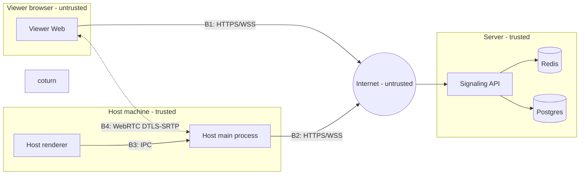

# 05 — Security & Threat Model

| | |
|---|---|
| Status | Draft v0.1 |
| Updated | 2026-10-23 |
| Method | STRIDE per container and data flow |
| Related | [01-hld.md](01-hld.md) · [04-protocol.md](04-protocol.md) · ADR-004 |

## 1. Assets to protect

| Asset | Why it matters |
|---|---|
| Host machine control | Anyone with this permission has full access like the Host user |
| Host screen content | May contain passwords, messages, personal data |
| Keystroke input | May contain passwords typed during the session |
| Session Code + OTP, tokens | Key to obtaining the two assets above |
| Signaling API availability | Without it, no one can connect |

## 2. Trust boundaries

All data passing through B1, B2, B4 from the Viewer side is considered **untrusted**, even from an approved Viewer. B3 is protected so that web content in the renderer cannot reach Node.js.

## 3. STRIDE analysis

### S — Spoofing

| # | Threat | Mitigation | Requirement |
|---|---|---|---|
| S1 | Guessing Session Code + OTP to enter the session | 9-digit code + 6-digit OTP; rate limit 5 attempts/IP/min; lock session after 5 failures; OTP expires in 10 minutes and is single-use; Host must always approve | FR-03a, FR-04, NFR-05 |
| S2 | Obtaining OTP (shoulder surfing, eavesdropping on a call) | Host must still approve and sees the requester's IP; single-use OTP | FR-04 |
| S3 | Impersonating Host with a leaked `hostToken` | Token kept only in Host App memory; transmitted only over TLS; bound to a single session | 04-protocol §2 |
| S4 | Forging JWTs | HS256 with secret ≥ 32 bytes; fixed algorithm on verification (block `alg: none`); app fails to start if secret is weak | LLD §9 |

**Quantitative analysis of S1:**
- Attacker does not know code: code space is ~9×10⁸, pending sessions are typically very few, and each IP is limited to 5 attempts/min. Probability of guessing a live session is near zero.
- Attacker already knows code (e.g. overheard): each OTP allows only 5 attempts before the session is locked, so probability of guessing correctly ≤ 5/10⁶ = 0.0005%. Host is notified via `session.locked`, and even if guessed correctly the Host must still approve.

Therefore, a 6-digit OTP (decision Q1) is sufficient when combined with the other layers.

### T — Tampering

| # | Threat | Mitigation |
|---|---|---|
| T1 | Tampering with SDP/ICE, frames, or input in transit | TLS for WS; DTLS-SRTP for WebRTC; DTLS fingerprint in SDP travels only over TLS |
| T2 | Viewer sends malformed payload to crash Host or server | Validated with zod on server and Host before execution; coordinates clamped to [0,1], wheel delta bounded |
| T3 | Modifying session state via race condition across multiple instances | Optimistic concurrency using Lua script (LLD §7) |

### R — Repudiation

| # | Threat | Mitigation |
|---|---|---|
| R1 | Inability to determine who joined and when | Audit log every domain event with IP and timestamp (FR-30) |
| R2 | Audit log is modified | Audit table is `INSERT`-only; app DB user has no `UPDATE/DELETE` permissions on this table |

### I — Information disclosure

| # | Threat | Mitigation |
|---|---|---|
| I1 | Screen content leaked in transit | WebRTC P2P end-to-end encrypted; TURN only relays encrypted packets |
| I2 | Server observes frames in relay mode | Frames reside only in memory during forwarding, never written to disk, never logged; resolution bounded on relay. **Accepted risk**, clearly documented in README |
| I3 | Leaking OTP/tokens via logs | `pino.redact` for `otp`, `*.token`, `authorization`; OTP stored only as argon2id hash |
| I4 | Leaking whether a code exists | Same 401 error for all join failures; dummy verify for uniform response time |
| I5 | Leaking real IP of Host/Viewer via ICE candidates | Accepted in v1 (required for P2P); forcing TURN only (`iceTransportPolicy: 'relay'`) as a future option |

### D — Denial of service

| # | Threat | Mitigation |
|---|---|---|
| D1 | Spamming session creation to exhaust code space | Rate limit 10/IP/min; codes expire after 10 minutes if unused |
| D2 | Spamming join requests | Rate limit 5/IP/min shared across instances (Redis) |
| D3 | Large or malformed payloads crashing server | 1 MB limit; schema validation; filter catches all exceptions, preventing process termination |
| D4 | Event flooding over relay | Limit per socket ~120 messages/s, drop excess; frame relay throttled by acks |
| D5 | Abuse of TURN as a free proxy | Ephemeral TURN credentials (HMAC) issued only to approved Viewers, expiring with the session; coturn blocks relay to internal IP ranges |

### E — Elevation of privilege

| # | Threat | Mitigation |
|---|---|---|
| E1 | Viewer invokes Host commands | `ActorGuard` based on `principal.kind`; mandatory e2e test |
| E2 | Observer sends input | Blocked at server (relay) **and** at Host (DataChannel does not traverse server) |
| E3 | Web content in Host renderer reaches Node.js (RCE) | `contextIsolation: true`, `nodeIntegration: false`, `sandbox: true`; preload exposes only select functions via `contextBridge`; validate IPC arguments; CSP blocks external scripts; no remote content loaded into Host window |
| E4 | XSS on Viewer Web to steal tokens | React escapes by default; `dangerouslySetInnerHTML` prohibited; CSP; tokens stored only in memory |

## 4. Residual risks (accepted in v1)

| Risk | Why accepted | Future mitigation |
|---|---|---|
| **"Tech support" scam**: attacker convinces victim to read code and approve | Cannot be solved purely by technical means | Approval dialog shows clear warnings and requester IP; emergency revoke button (FR-24) |
| Server sees frames in relay mode | Necessary to function when WebRTC is blocked | Application-level end-to-end frame encryption with keys exchanged over DataChannel |
| Approved Viewer has full privileges like Host user | Core functionality of remote desktop | Optional blocked keys/combinations list |
| Inability to control Windows UAC (secure desktop) screen | Limitation of user-mode input simulation | Documented in README |
| Single shared `JWT_SECRET`, manual rotation | Simple for v1 | Multi-key (`kid`) support |
| Loss of audit events if process dies between save and publish | Accepted for v1 (02-domain-model §5) | Outbox pattern |

## 5. Security testing

| Test | Layer |
|---|---|
| 5 failed join attempts → session `Locked`, 6th attempt with correct OTP still rejected | Domain unit + REST E2E |
| All join failure reasons return the same `401 INVALID_CREDENTIALS` | REST E2E |
| Exceeding 5 requests/IP/min → `429` with `Retry-After`, shared count across 2 instances | REST E2E |
| Token with `alg: none`, invalid signature, expired, wrong `kind` → `UNAUTHORIZED` | `JwtTokenService` unit + WS E2E |
| Viewer sends `join.approve` → `FORBIDDEN` | WS E2E |
| Observer sends `relay.input` → `FORBIDDEN`; Host ignores DataChannel input when Observer | WS E2E + host-core unit |
| Payload > 1 MB → disconnect; invalid schema payload → `INVALID_INPUT`, server stays alive | WS E2E |
| Logs do not contain OTP/tokens (verify logger output in tests) | Integration |
| Electron configuration correct (`contextIsolation`, `sandbox`, no `nodeIntegration`) | Unit test verifying `BrowserWindow` creation options |
| `npm audit`/Dependabot report no high-severity vulnerabilities | CI |

## 6. Deployment checklist

- [ ] HTTPS/WSS mandatory; HTTP redirects to HTTPS; HSTS.
- [ ] `JWT_SECRET`, `TURN_SECRET` generated randomly, stored outside repo.
- [ ] Redis and Postgres not exposed to the Internet.
- [ ] coturn: `use-auth-secret`, `denied-peer-ip` for internal ranges, bandwidth limit per session.
- [ ] Reverse proxy sets `X-Forwarded-For` correctly; app trusts only 1 proxy.
- [ ] Electron build is code-signed (if certificate available) or notes SmartScreen warning.
