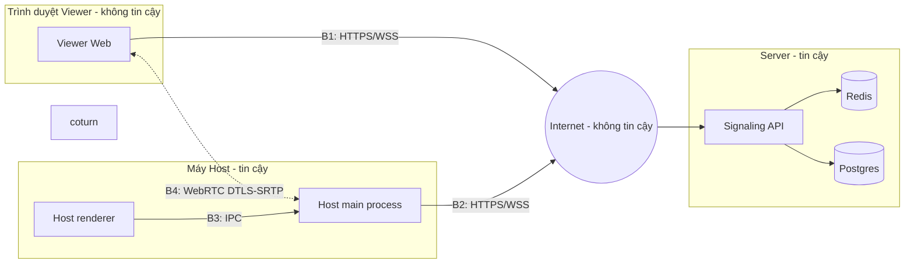

# 05 — Security & Threat Model

| | |
|---|---|
| Trạng thái | Draft v0.1 |
| Cập nhật | 2026-10-23 |
| Phương pháp | STRIDE theo từng container và luồng dữ liệu |
| Liên quan | [01-hld.md](01-hld.md) · [04-protocol.md](04-protocol.md) · ADR-004 |

## 1. Tài sản cần bảo vệ

| Tài sản | Vì sao quan trọng |
|---|---|
| Quyền điều khiển máy Host | Ai có quyền này có toàn quyền như người dùng Host |
| Nội dung màn hình Host | Có thể chứa mật khẩu, tin nhắn, dữ liệu cá nhân |
| Thao tác bàn phím | Có thể chứa mật khẩu được gõ trong phiên |
| Session Code + OTP, token | Là chìa khoá để có hai tài sản trên |
| Tính sẵn sàng của Signaling API | Không có nó thì không ai kết nối được |

## 2. Ranh giới tin cậy

Mọi dữ liệu đi qua B1, B2, B4 từ phía Viewer đều coi là **không tin cậy**, kể cả từ Viewer đã được duyệt. B3 được bảo vệ để nội dung web trong renderer không chạm được tới Node.js.

## 3. Phân tích STRIDE

### S — Spoofing (giả mạo danh tính)

| # | Mối đe doạ | Giảm thiểu | Yêu cầu |
|---|---|---|---|
| S1 | Đoán Session Code + OTP để vào phiên | Mã 9 số + OTP 6 số; rate limit 5 lần/IP/phút; khoá phiên sau 5 lần sai; OTP hết hạn 10 phút và dùng một lần; Host luôn phải duyệt | FR-03a, FR-04, NFR-05 |
| S2 | Lấy được OTP (nhìn trộm, nghe lén cuộc gọi) | Host vẫn phải duyệt và thấy IP người xin vào; OTP dùng một lần | FR-04 |
| S3 | Giả mạo Host bằng `hostToken` bị lộ | Token chỉ giữ trong bộ nhớ Host App; chỉ truyền qua TLS; gắn với một phiên | 04-protocol §2 |
| S4 | Giả JWT | HS256 với secret ≥ 32 byte; cố định thuật toán khi verify (chặn `alg: none`); app không khởi động nếu secret yếu | LLD §9 |

**Phân tích S1 bằng số:**
- Kẻ tấn công chưa biết mã: không gian mã khoảng 9×10⁸, số phiên đang chờ thường rất nhỏ, và mỗi IP chỉ được 5 lần/phút. Xác suất đoán trúng một phiên đang sống gần như bằng 0.
- Kẻ tấn công đã biết mã (ví dụ nghe được): mỗi OTP chỉ cho 5 lần thử trước khi phiên bị khoá, nên xác suất đoán đúng ≤ 5/10⁶ = 0.0005%. Host được báo `session.locked`, và kể cả đoán đúng thì Host vẫn phải bấm duyệt.

Vì vậy OTP 6 chữ số (quyết định Q1) là đủ khi đi cùng các lớp còn lại.

### T — Tampering (sửa dữ liệu)

| # | Mối đe doạ | Giảm thiểu |
|---|---|---|
| T1 | Sửa SDP/ICE, frame hoặc input trên đường truyền | TLS cho WS; DTLS-SRTP cho WebRTC; fingerprint DTLS nằm trong SDP vốn chỉ đi qua kênh TLS |
| T2 | Viewer gửi payload dị dạng để làm hỏng Host hoặc server | Validate bằng zod ở server và ở Host trước khi thực thi; toạ độ bị kẹp trong [0,1], wheel bị giới hạn |
| T3 | Sửa trạng thái phiên bằng race condition giữa nhiều instance | Optimistic concurrency bằng Lua script (LLD §7) |

### R — Repudiation (chối bỏ)

| # | Mối đe doạ | Giảm thiểu |
|---|---|---|
| R1 | Không biết ai đã vào, vào lúc nào | Audit log mọi domain event kèm IP và thời điểm (FR-30) |
| R2 | Audit log bị sửa | Bảng audit chỉ `INSERT`; user DB của app không có quyền `UPDATE/DELETE` trên bảng này |

### I — Information disclosure (lộ thông tin)

| # | Mối đe doạ | Giảm thiểu |
|---|---|---|
| I1 | Lộ nội dung màn hình khi truyền | WebRTC P2P mã hoá đầu-cuối; TURN chỉ chuyển gói đã mã hoá |
| I2 | Server thấy frame ở chế độ relay | Frame chỉ nằm trong bộ nhớ khi chuyển tiếp, không ghi đĩa, không log; giới hạn độ phân giải ở relay. **Rủi ro chấp nhận**, ghi rõ trong README |
| I3 | Lộ OTP/token qua log | `pino.redact` cho `otp`, `*.token`, `authorization`; OTP chỉ lưu dạng hash argon2id |
| I4 | Lộ "mã có tồn tại không" | Cùng một lỗi 401 cho mọi thất bại join; verify giả để thời gian phản hồi tương đương |
| I5 | Lộ IP thật của Host/Viewer qua ICE candidate | Chấp nhận trong v1 (cần cho P2P); có thể ép chỉ dùng TURN (`iceTransportPolicy: 'relay'`) như một tuỳ chọn sau này |

### D — Denial of service

| # | Mối đe doạ | Giảm thiểu |
|---|---|---|
| D1 | Spam tạo phiên làm cạn không gian mã | Rate limit 10/IP/phút; mã hết hạn sau 10 phút nếu không dùng |
| D2 | Spam join | Rate limit 5/IP/phút dùng chung giữa các instance (Redis) |
| D3 | Payload lớn hoặc dị dạng làm sập server | Giới hạn 1 MB; validate schema; filter bắt mọi lỗi, không để exception làm chết process |
| D4 | Lũ sự kiện qua relay | Giới hạn mỗi socket ~120 message/giây, vượt thì bỏ; frame relay đi theo ack nên tự bị giới hạn |
| D5 | Lạm dụng TURN làm proxy miễn phí | Credential TURN tạm thời (HMAC) chỉ cấp cho Viewer đã được duyệt, hết hạn cùng phiên; coturn chặn relay tới dải IP nội bộ |

### E — Elevation of privilege (leo quyền)

| # | Mối đe doạ | Giảm thiểu |
|---|---|---|
| E1 | Viewer gọi lệnh của Host | `ActorGuard` theo `principal.kind`; e2e test bắt buộc |
| E2 | Observer gửi input | Chặn ở server (relay) **và** ở Host (DataChannel không đi qua server) |
| E3 | Nội dung web trong renderer Host chạm được Node.js (RCE) | `contextIsolation: true`, `nodeIntegration: false`, `sandbox: true`; preload chỉ expose vài hàm qua `contextBridge`; validate tham số IPC; CSP chặn script ngoài; không tải nội dung remote vào cửa sổ Host |
| E4 | XSS trên Viewer Web để lấy token | React escape mặc định; cấm `dangerouslySetInnerHTML`; CSP; token chỉ trong bộ nhớ |

## 4. Rủi ro còn tồn tại (chấp nhận trong v1)

| Rủi ro | Lý do chấp nhận | Hướng xử lý sau này |
|---|---|---|
| **Lừa đảo kiểu "hỗ trợ kỹ thuật"**: kẻ gian thuyết phục nạn nhân đọc mã và bấm duyệt | Không giải quyết được bằng kỹ thuật thuần | Hộp thoại duyệt hiển thị cảnh báo rõ ràng và IP; nút thu hồi khẩn cấp (FR-24) |
| Server thấy frame ở chế độ relay | Cần để hoạt động khi WebRTC bị chặn | Mã hoá frame đầu-cuối ở tầng ứng dụng bằng khoá trao đổi qua DataChannel |
| Viewer được duyệt có toàn quyền như người dùng Host | Đó là chức năng của remote desktop | Danh sách phím/tổ hợp bị chặn tuỳ chọn |
| Không điều khiển được màn hình UAC (secure desktop) trên Windows | Giới hạn của việc giả lập input ở user mode | Ghi chú trong README |
| Một `JWT_SECRET` dùng chung, xoay vòng thủ công | Đơn giản cho v1 | Hỗ trợ nhiều khoá (`kid`) |
| Mất event audit nếu process chết giữa lưu và publish | Chấp nhận cho v1 (02-domain-model §5) | Outbox |

## 5. Kiểm thử bảo mật

| Test | Tầng |
|---|---|
| Join sai 5 lần → phiên `Locked`, lần 6 đúng OTP vẫn bị từ chối | Unit domain + E2E REST |
| Mọi lý do join thất bại trả cùng một `401 INVALID_CREDENTIALS` | E2E REST |
| Vượt 5 request/IP/phút → `429` kèm `Retry-After`, đếm chung giữa 2 instance | E2E REST |
| Token `alg: none`, chữ ký sai, hết hạn, sai `kind` → `UNAUTHORIZED` | Unit `JwtTokenService` + E2E WS |
| Viewer gửi `join.approve` → `FORBIDDEN` | E2E WS |
| Observer gửi `relay.input` → `FORBIDDEN`; Host bỏ qua input DataChannel khi là Observer | E2E WS + unit host-core |
| Payload > 1 MB → ngắt kết nối; payload sai schema → `INVALID_INPUT`, server vẫn sống | E2E WS |
| Log không chứa OTP/token (kiểm tra output logger trong test) | Integration |
| Cấu hình Electron đúng (`contextIsolation`, `sandbox`, không `nodeIntegration`) | Unit kiểm tra options tạo `BrowserWindow` |
| `npm audit`/Dependabot không có lỗ hổng mức high | CI |

## 6. Checklist khi deploy

- [ ] HTTPS/WSS bắt buộc; HTTP chuyển hướng sang HTTPS; HSTS.
- [ ] `JWT_SECRET`, `TURN_SECRET` sinh ngẫu nhiên, lưu ngoài repo.
- [ ] Redis và Postgres không mở ra Internet.
- [ ] coturn: `use-auth-secret`, `denied-peer-ip` cho dải nội bộ, giới hạn băng thông mỗi phiên.
- [ ] Reverse proxy đặt `X-Forwarded-For` đúng; app chỉ tin 1 proxy.
- [ ] Bản build Electron có ký mã (nếu có chứng chỉ) hoặc ghi chú cảnh báo SmartScreen.
