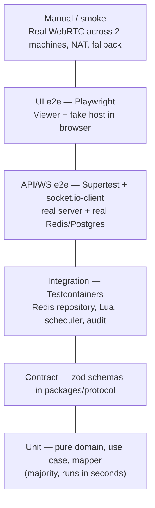
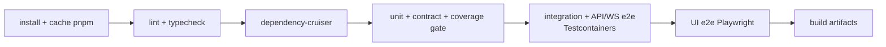

# 06 — Test Strategy

| | |
|---|---|
| Status | Draft v0.1 |
| Updated | 2026-10-23 |
| Related | [02-domain-model.md §8](02-domain-model.md) · [03-lld/session-access.md §11](03-lld/session-access.md) · [05-security.md §5](05-security.md) |

## 1. Goals

- Every requirement (FR/NFR) and every bug from the 2021 version (L1–L14) has at least one test proving it.
- Fast tests at lower layers, few but realistic tests at upper layers.
- Tests as living documentation: reading a test name reveals the business rule.

## 2. Test Pyramid



| Layer | Scope | Tool | Run on | Target duration |
|---|---|---|---|---|
| Unit | Domain `RemoteSession`, VOs, use cases with fake ports, input mapper, coordinates, fallback detection | Vitest | Every file save (watch), every commit | < 10 s |
| Contract | Every schema in `packages/protocol` with valid/invalid samples | Vitest + zod | Every commit | < 5 s |
| Integration | `RedisSessionRepository`, Lua scripts, `RedisDeadlineScheduler`, Postgres audit, logger redact | Vitest + Testcontainers | Every PR | < 2 min |
| API/WS e2e | All use cases via REST/WS, security (05 §5), 2 instances + Redis adapter | Vitest + Supertest + `socket.io-client` + Testcontainers | Every PR | < 3 min |
| UI e2e | Viewer: enter code → wait for approval → receive video → send input; fallback relay | Playwright (Chromium, `--use-fake-ui-for-media-stream`) | Every PR to `develop` | < 5 min |
| Host smoke | Electron starts with correct security configuration, preload exposes correct APIs | Playwright `_electron` | Before release | < 2 min |
| Manual | WebRTC between 2 real machines, different networks, TURN, poor network, DPI 125–150% | Checklist §8 | Before release | 30 min |
| Performance | fps, latency, bandwidth | Benchmark script + `getStats` | Week 5, before release | — |

**Integration tests** are named `*.int.test.ts` under `apps/*/test/integration/`, run with `pnpm test:integration` (excluded from `pnpm test` / `pnpm run check` so machines without Docker can still run). Redis is picked up from `REDIS_URL` if set (e.g. local `redis-server`), otherwise Testcontainers spins up `redis:7-alpine`. Each test uses a random key prefix so files run concurrently against the same Redis. Adapters covered only by integration tests (currently `infrastructure/redis/**`) are excluded from unit test coverage thresholds. CI runs both.

**A single test runner for the entire monorepo:** Vitest (NestJS uses `unplugin-swc` for decorator metadata support). Rationale: consistent syntax, shared coverage configuration, fast, executes TypeScript directly.

## 3. Design for Testability

- **Pure domain**: no I/O, no system clock; `now` and `SessionPolicy` passed in.
- **Ports & adapters**: all I/O behind interfaces, with in-memory implementations for unit tests (`InMemorySessionRepository`, `FixedClock`, `FakeHasher`, `CollectingEventPublisher`, `ManualScheduler`).
- **`packages/host-core`**: Host-side logic (input mapping, role verification, relay loop, signaling handling) isolated from Electron. Electron is solely an adapter (screen capture, robotjs). This enables:
  - unit testing all Host logic without Electron;
  - Playwright constructing a **fake host running in the browser** (using mocked `getDisplayMedia` + `host-core`) to test end-to-end WebRTC in CI.
- **Compressed configuration for tests**: `SESSION_POLICY_*` variables allow second-granularity TTLs in e2e tests.

## 4. TDD Workflow

1. Pick a row from the test list (02-domain-model §8 or the state transition table §4.6).
2. **Red**: write a test, run it to verify it fails for the expected reason.
3. **Green**: write the minimum code to make it pass.
4. **Refactor**: clean up code and tests, keep green.
5. Small commits: `test(session): …` then `feat(session): …`, or combined if very small.

Apply strict TDD to: domain, use cases, input mapper, protocol schemas, Lua scripts (via integration tests).
Do not enforce TDD for: framework glue code (Electron window, NestJS module configuration), UI layout. These parts are covered by e2e and smoke tests.

## 5. Test Conventions

- Test names describe behavior using ubiquitous language: `it("locks the session after the 5th wrong OTP")`.
- **Arrange – Act – Assert** structure, each test verifying a single behavior.
- **Test data builders** instead of large fixtures:
  ```ts
  const session = aSession().waitingForViewer().withFailedAttempts(4).build();
  ```
- **Table-driven** for command × state matrix (02 §4.6) and key mapping table:
  ```ts
  it.each(transitions)("$command in $status → $expected", ({ … }) => { … });
  ```
- No `sleep` in tests; time controlled via `FixedClock` or shortened TTLs with conditional waits.
- Each integration/e2e test generates its own isolated data (random sessionId), avoiding execution order dependencies.

## 6. Traceability Matrix (Summary)

| Requirement | Primary test | Layer |
|---|---|---|
| FR-01, FR-08 | Create session, expire after WAITING_TTL | Unit + E2E |
| FR-03, FR-03a | Join correct/wrong, lock after 5 attempts | Unit + E2E |
| FR-04, FR-05, D1, D2 | Approve/reject, OTP consumed on join request, 60s timeout | Unit + E2E WS |
| FR-09, I1 | Two concurrent Join Requests, only one succeeds | Integration |
| FR-09a | Warning 5 minutes prior, expire after 2 hours | Unit + Integration scheduler |
| FR-11 | Fallback when ICE fails | UI e2e (block ICE via configuration) |
| FR-20, FR-21, FR-22 (L1–L4) | Key mapping table, normalized coordinates + DPI | Unit host-core |
| FR-23 | Observer blocked at server and Host | E2E WS + unit host-core |
| NFR-05, NFR-06 | Rate limits, invalid/oversized payloads | E2E |
| NFR-07 | Two server instances sharing Redis adapter | E2E |
| NFR-08 | Electron security configuration | Unit + Host smoke |
| NFR-10 | Logs contain no OTP/tokens | Integration |
| NFR-01…03 | fps, latency, bandwidth | Performance (benchmark.md) |

The full matrix is maintained as a table in this file as implementation progresses.

## 7. Coverage & CI

| Package | Threshold (lines/branches) |
|---|---|
| `apps/server/src/*/domain` | ≥ 90% / ≥ 90% |
| `apps/server/src/*/application` | ≥ 85% / ≥ 80% |
| `packages/protocol`, `packages/host-core` | ≥ 90% / ≥ 85% |
| Remaining | No threshold set; rely on e2e |

Coverage is a minimum quality gate, not a goal: a test with no assertions still increases coverage.

**GitHub Actions Pipeline:**

Turborepo rebuilds only packages affected by changes.

## 8. Manual Testing Checklist (Pre-Release)

- [ ] Two machines on same LAN: WebRTC connects, display mode shows `webrtc`.
- [ ] Two different networks (one machine on 4G): connects via TURN.
- [ ] Block UDP on Viewer machine: automatically switches to `relay` in ≤ 10 seconds.
- [ ] Host Windows display scale 125% and 150%: click hits accurate coordinates in all four screen corners.
- [ ] Type English characters, numbers, special symbols, shortcuts Ctrl+C/Ctrl+V, Alt+Tab, arrow keys, F1–F12.
- [ ] Switch to Observer mid-session: input blocked immediately.
- [ ] Emergency revoke shortcut works.
- [ ] Unplug Viewer network for 10 seconds then reconnect: session resumes; exceeding 15 seconds: session terminates.
- [ ] Session expires at exactly 2 hours (run with shortened `SESSION_POLICY_MAX_ACTIVE`).

## 9. Definition of Done for a PR

- [ ] Tests written before or alongside code; CI green.
- [ ] Coverage does not drop below the thresholds of the relevant package.
- [ ] New/changed payloads added to `packages/protocol` and documented in `04-protocol.md`.
- [ ] Design changes reflected in LLD updates or new/edited ADR.
- [ ] Self-review against checklist: ubiquitous language in naming, no sensitive data logged, errors mapped to proper codes.
