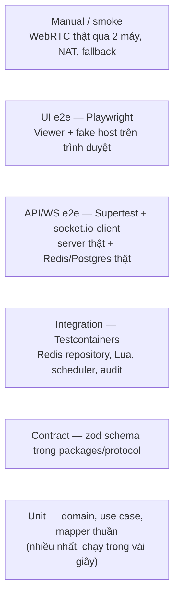
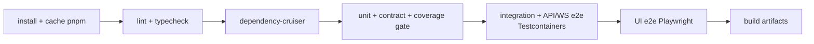

# 06 — Test Strategy

| | |
|---|---|
| Trạng thái | Draft v0.1 |
| Cập nhật | 2026-10-23 |
| Liên quan | [02-domain-model.md §8](02-domain-model.md) · [03-lld/session-access.md §11](03-lld/session-access.md) · [05-security.md §5](05-security.md) |

## 1. Mục tiêu

- Mỗi yêu cầu (FR/NFR) và mỗi lỗi của bản 2021 (L1–L14) đều có ít nhất một test chứng minh.
- Test nhanh ở tầng dưới, ít nhưng thật ở tầng trên.
- Test là tài liệu sống: đọc tên test là biết luật nghiệp vụ.

## 2. Kim tự tháp test



| Tầng | Phạm vi | Công cụ | Chạy khi | Thời gian mục tiêu |
|---|---|---|---|---|
| Unit | Domain `RemoteSession`, VO, use case với port giả, input mapper, toạ độ, phát hiện fallback | Vitest | Mỗi lần lưu file (watch), mỗi commit | < 10 giây |
| Contract | Mọi schema trong `packages/protocol` với mẫu hợp lệ/không hợp lệ | Vitest + zod | Mỗi commit | < 5 giây |
| Integration | `RedisSessionRepository`, Lua script, `RedisDeadlineScheduler`, audit Postgres, logger redact | Vitest + Testcontainers | Mỗi PR | < 2 phút |
| API/WS e2e | Toàn bộ use case qua REST/WS, bảo mật (05 §5), 2 instance + Redis adapter | Vitest + Supertest + `socket.io-client` + Testcontainers | Mỗi PR | < 3 phút |
| UI e2e | Viewer: nhập mã → chờ duyệt → nhận hình → gửi input; fallback relay | Playwright (Chromium, `--use-fake-ui-for-media-stream`) | Mỗi PR vào `develop` | < 5 phút |
| Host smoke | Electron khởi động đúng cấu hình bảo mật, preload expose đúng API | Playwright `_electron` | Trước release | < 2 phút |
| Manual | WebRTC giữa 2 máy thật, mạng khác nhau, TURN, mạng yếu, DPI 125–150% | Checklist §8 | Trước release | 30 phút |
| Performance | fps, độ trễ, băng thông | Script đo + `getStats` | Tuần 5, trước release | — |

**Một test runner cho cả monorepo:** Vitest (NestJS dùng `unplugin-swc` để hỗ trợ decorator metadata). Lý do: cùng cú pháp, cùng cấu hình coverage, nhanh, chạy được TypeScript trực tiếp.

## 3. Thiết kế để test được

- **Domain thuần**: không I/O, không đồng hồ hệ thống; `now` và `SessionPolicy` truyền vào.
- **Port & adapter**: mọi I/O đi qua interface, có bản in-memory cho unit test (`InMemorySessionRepository`, `FixedClock`, `FakeHasher`, `CollectingEventPublisher`, `ManualScheduler`).
- **`packages/host-core`**: logic phía Host (ánh xạ input, kiểm tra role, vòng lặp relay, xử lý signaling) tách khỏi Electron. Electron chỉ là adapter (chụp màn hình, robotjs). Nhờ vậy:
  - unit test được toàn bộ logic Host mà không cần Electron;
  - Playwright dựng được một **fake host chạy trong trình duyệt** (dùng `getDisplayMedia` giả + `host-core`) để test end-to-end WebRTC trong CI.
- **Cấu hình rút gọn cho test**: biến `SESSION_POLICY_*` cho phép TTL tính bằng giây trong e2e.

## 4. Quy trình TDD

1. Chọn một dòng trong danh sách test (02-domain-model §8 hoặc bảng chuyển trạng thái §4.6).
2. **Red**: viết test, chạy để thấy nó fail đúng lý do.
3. **Green**: viết code tối thiểu để pass.
4. **Refactor**: dọn code và test, giữ xanh.
5. Commit nhỏ: `test(session): …` rồi `feat(session): …`, hoặc gộp nếu rất nhỏ.

Áp dụng TDD chặt cho: domain, use case, input mapper, schema protocol, Lua script (qua integration test).
Không ép TDD cho: code kết nối thư viện (Electron window, cấu hình NestJS module), UI layout. Những phần này được che bởi e2e và smoke test.

## 5. Quy ước viết test

- Tên test mô tả hành vi bằng ngôn ngữ domain: `it("locks the session after the 5th wrong OTP")`.
- Cấu trúc **Arrange – Act – Assert**, mỗi test kiểm một hành vi.
- **Test data builder** thay cho fixture lớn:
  ```ts
  const session = aSession().waitingForViewer().withFailedAttempts(4).build();
  ```
- **Table-driven** cho ma trận lệnh × trạng thái (02 §4.6) và bảng ánh xạ phím:
  ```ts
  it.each(transitions)("$command in $status → $expected", ({ … }) => { … });
  ```
- Không dùng `sleep` trong test; thời gian được điều khiển bằng `FixedClock` hoặc TTL rút gọn kèm chờ theo điều kiện.
- Mỗi test integration/e2e tự tạo dữ liệu riêng (sessionId ngẫu nhiên), không phụ thuộc thứ tự chạy.

## 6. Ma trận truy vết (rút gọn)

| Yêu cầu | Test chính | Tầng |
|---|---|---|
| FR-01, FR-08 | Tạo phiên, hết hạn sau WAITING_TTL | Unit + E2E |
| FR-03, FR-03a | Join đúng/sai, khoá sau 5 lần | Unit + E2E |
| FR-04, FR-05, D1, D2 | Duyệt/từ chối, OTP tiêu thụ khi xin vào, timeout 60s | Unit + E2E WS |
| FR-09, I1 | Hai Join Request song song chỉ một thành công | Integration |
| FR-09a | Cảnh báo trước 5 phút, hết hạn sau 2 giờ | Unit + Integration scheduler |
| FR-11 | Fallback khi ICE fail | UI e2e (chặn ICE bằng cấu hình) |
| FR-20, FR-21, FR-22 (L1–L4) | Bảng ánh xạ phím, toạ độ chuẩn hoá + DPI | Unit host-core |
| FR-23 | Observer bị chặn ở server và Host | E2E WS + unit host-core |
| NFR-05, NFR-06 | Rate limit, payload lỗi/quá lớn | E2E |
| NFR-07 | Hai instance server dùng chung Redis adapter | E2E |
| NFR-08 | Cấu hình bảo mật Electron | Unit + Host smoke |
| NFR-10 | Log không chứa OTP/token | Integration |
| NFR-01…03 | fps, độ trễ, băng thông | Performance (benchmark.md) |

Ma trận đầy đủ được duy trì dưới dạng bảng trong file này khi implement.

## 7. Coverage & CI

| Gói | Ngưỡng (lines/branches) |
|---|---|
| `apps/server/src/*/domain` | ≥ 90% / ≥ 90% |
| `apps/server/src/*/application` | ≥ 85% / ≥ 80% |
| `packages/protocol`, `packages/host-core` | ≥ 90% / ≥ 85% |
| Còn lại | Không đặt ngưỡng; dựa vào e2e |

Coverage là cổng tối thiểu, không phải mục tiêu: một test không có assert vẫn tăng coverage.

**Pipeline GitHub Actions:**

Turborepo chỉ chạy lại các gói bị ảnh hưởng bởi thay đổi.

## 8. Checklist kiểm thử thủ công (trước release)

- [ ] Hai máy cùng LAN: WebRTC kết nối, chế độ hiển thị `webrtc`.
- [ ] Hai mạng khác nhau (một máy dùng 4G): kết nối qua TURN.
- [ ] Chặn UDP trên máy Viewer: tự chuyển `relay` trong ≤ 10 giây.
- [ ] Host Windows scale 125% và 150%: click đúng vị trí ở bốn góc màn hình.
- [ ] Gõ tiếng Anh, số, ký tự đặc biệt, tổ hợp Ctrl+C/Ctrl+V, Alt+Tab, mũi tên, F1–F12.
- [ ] Đổi sang Observer giữa chừng: input bị chặn ngay.
- [ ] Phím tắt thu hồi khẩn cấp hoạt động.
- [ ] Rút mạng Viewer 10 giây rồi cắm lại: phiên tiếp tục; quá 15 giây: phiên kết thúc.
- [ ] Phiên hết hạn đúng 2 giờ (chạy với `SESSION_POLICY_MAX_ACTIVE` rút gọn).

## 9. Definition of Done cho một PR

- [ ] Test được viết trước hoặc cùng lúc với code; CI xanh.
- [ ] Không giảm coverage dưới ngưỡng của gói liên quan.
- [ ] Payload mới/đổi đã có trong `packages/protocol` và cập nhật `04-protocol.md`.
- [ ] Thiết kế thay đổi thì cập nhật LLD hoặc thêm/sửa ADR.
- [ ] Tự review theo checklist: đặt tên theo ubiquitous language, không log dữ liệu nhạy cảm, lỗi được ánh xạ đúng mã.
